# 预算约束长程任务执行架构

> 状态：实验性架构方案；计划 API、SDK 调用级预算、首批自动验收、中止恢复、OAT/SDK 工具副作用网关与首批状态查询已接入生产骨架。Provider 权威计费、其他外部工具 Adapter 及长期运行集成仍未完成；默认关闭。任务状态以[实施进度表](./budgeted-long-horizon-execution-task-breakdown.md#0-当前实施状态)为准。
>
> 最后更新：2026-10-16（工具副作用网关与首批状态查询）。
>
> 本文是 OAT 在给定资金、Token、工具调用和时间预算下，规划、排期并持续执行数天至数月任务的实验性实现依据。本文描述目标架构、状态机、数据模型、预算算法、故障恢复、接口、可观测性、完整时序和落地顺序；不表示仓库当前已经提供这些能力。功能未显式启用时，不创建相关数据库、定时器、API 或 Agent 工具，也不改变现有 TaskManager、Runtime 和 UsageTracker 行为。
>
> 可执行工程 Backlog：[预算约束长程任务：可执行任务拆分](./budgeted-long-horizon-execution-task-breakdown.md)

## 0. 实验性功能策略

预算约束长程执行在完成调用级门控、账本一致性、故障注入和灰度验证前属于实验性能力，必须遵循：

1. 默认 `enabled=false`，升级现有 Project 不会自动启用。
2. 首次启用默认只能进入 `shadow`，只估算和记录，不拒绝调用、不改变模型、不自动降级范围。
3. `soft` 只产生预算告警、重规划建议和人工确认，不实施硬阻断。
4. `hard` 才执行调用前 reservation、硬拒绝和自动策略，但必须通过运行时能力、Provider 计费能力和恢复能力预检。
5. Desktop 必须持续展示“实验性”标识、当前模式和保证边界；不得将 shadow/soft 描述为预算保证。
6. 禁用后停止新调度和实验性后台服务，但必须允许只读查看、对账和安全 closeout 已存在的实验 Program。
7. 实验数据库和事件使用独立 Schema version；禁用或回滚功能不能删除历史账本。
8. `hard` 模式需要用户显式确认实验风险；配置文件中的单个布尔值不能绕过能力预检。

```ts
type BudgetExecutionMode = "shadow" | "soft" | "hard";
```

模式能力矩阵：

| 能力 | disabled | shadow | soft | hard |
| --- | --- | --- | --- | --- |
| 成本估算与偏差记录 | 否 | 是 | 是 | 是 |
| 预算/UI 告警 | 否 | 只记录 | 是 | 是 |
| 自动创建 Program 计划 | 否 | 可选 | 是 | 是 |
| 阻止模型或工具调用 | 否 | 否 | 否 | 是 |
| 自动范围降级 | 否 | 否 | 仅建议 | 按预授权策略 |
| 硬预算承诺 | 否 | 否 | 否 | 仅通过能力预检后 |

## 1. 背景与问题定义

当前 OAT 已具备 Admin → Leader → Worker 的任务委派、Agent 级 FIFO 队列、父子任务、交付报告、任务快照、暂停/恢复、进程启动恢复、Git 协作和模型用量记录。但现有实现仍属于“先执行、后统计”的成本模型：

- `UsageTracker` 在 Assistant 消息结束后记录用量，不能在调用之前阻止超支；
- `TaskManager` 只判断 Agent 和队列是否可运行，不判断全局预算及剩余任务是否仍可完成；
- Task 没有估算分布、预算账户、交付层级、截止时间、依赖 DAG 和验收契约；
- Admin 可以生成计划，但没有独立的确定性组件验证计划是否可行；
- 数天至数月的任务不能依赖单次 Prompt、常驻会话或内存定时器；
- 失败重试、并行 Worker、上下文膨胀和最终验证都可能在任务尾部集中消耗预算。

本设计解决以下问题：

> 用户给 Admin 一个总预算和目标。Admin 如何在开始前生成可执行、可降级、可验收的计划，并在数天至数月内持续排期执行，使系统严格不超出可控制预算，同时尽量保证至少完成一个预先约定的最小可交付闭环，而不是预算耗尽后在任意中间状态停止。

## 2. 目标、非目标与保证边界

### 2.1 目标

1. 对系统可控制的模型、工具和外部服务开销实施硬预算上限。
2. Admin 负责语义规划；确定性控制面负责估算校验、准入、预留、结算和调度。
3. 任务开始前判断最小交付范围是否具有足够的完成概率。
4. 先保护最小交付和收尾预算，再执行标准及增强范围。
5. 在每个里程碑重新估算，必要时自动缩小范围或重新排期。
6. 所有长程任务由短时、有界、可验证、可恢复的 Work Package 构成。
7. 进程重启、模型超时、重复事件和网络不确定结果不会导致重复扣费或重复副作用。
8. 支持美元、输入 Token、输出 Token、工具调用、外部额度和截止时间等多维预算。
9. 所有预算决策、计划版本、估算、扣费和降级均可审计。
10. 在当前 OAT 架构上渐进落地，不要求一次替换全部调度和记忆模块。

### 2.2 非目标

- 不承诺对未知研究任务实现数学意义上的 100% 完成保证。
- 不允许 Agent 自己修改根预算或绕过账本。
- 不在首期使用强化学习训练预算策略；先实现可解释的确定性策略。
- 不把一个月的工作实现为一个月不结束的 LLM 会话。
- 不将“产出了一段 Assistant 文本”视为任务完成；必须通过验收契约。
- 不用平均成本作为唯一准入依据。

### 2.3 系统可提供的保证

满足下列前提时，系统可以提供硬预算保证：

- 每种受控资源都有可计算或保守上界；
- 模型调用设置最大输出 Token；
- Runtime 能在每一次初始调用和工具续轮调用之前执行 OAT Guard，而不只是事后上报 usage；
- 外部付费工具在调用前声明最大成本；
- 所有消费路径必须经过统一 Budget Guard；
- 未报告 usage 时按保守上界结算；
- 价格在任务创建时形成不可变 Pricing Snapshot；
- Provider 的计费能力、幂等能力和对账能力已通过 hard-mode 预检；
- Program 及其 Queue、Attempt、Reservation 使用同一个事务事实源。

在这些前提下必须保持以下不变量：

```text
spent + active_reservations <= hard_limit
available = hard_limit - spent - active_reservations
closeout_reserve 不能被普通执行账户消费
任何调用在没有有效 reservation 时不得发送
同一个 usage/副作用事件最多结算一次
```

对人工时间、不可预知的第三方价格变化和系统控制面之外产生的费用，只能通过显式契约和风险提示管理，不能声称硬保证。若上述任一前提不满足，系统必须自动降级为 `soft` 或 `shadow`，禁止在 UI、API 或最终报告中宣称硬预算保证。

## 3. 研究依据与设计推论

| 工作 | 证据状态 | 可采用结论 | 在本设计中的落点 |
| --- | --- | --- | --- |
| [BAMAS, AAAI 2026](https://ojs.aaai.org/index.php/AAAI/article/view/40226) | 同行评审会议论文 | 模型组合和协作拓扑可在显式预算约束下联合选择 | Planner Candidate 与模型/拓扑选择器 |
| [Towards Budget-Aware Agents, 2026](https://openreview.net/pdf?id=27CuUBRFXR) | 审稿中/预备工作 | 预算意识应在执行中持续估计；任务能力不等于估算校准能力 | 仅作为设计启发；Agent 提供估算建议，Controller 最终决定 |
| [AGENT*, 2026](https://openreview.net/pdf?id=lifeoGrKRB) | 审稿中 | 短期动作和长期低成本推演应联合使用 | 每个检查点做局部决策，同时维护剩余 DAG 的低成本预测 |
| [Budget-Aware Value Tree, 2026](https://arxiv.org/abs/2603.12634) | 预印本 | 剩余预算下降时应从探索切换为聚焦利用 | 仅用于启发 Budget Mode，不作为生产保证依据 |
| [Budget-Constrained Agentic Search, LREC 2026](https://aclanthology.org/2026.lrec-1.808/) | 同行评审会议论文 | 剩余预算应显式提供，但工具调用必须由框架门控 | Prompt 中提供预算视图，实际限制由 Tool/Model Guard 执行 |
| [Plan-and-Act, ICML 2025](https://proceedings.mlr.press/v267/erdogan25a.html) | 同行评审会议论文 | 规划、执行和动态重规划分离可提升长程任务表现 | Admin Planner、Work Package Executor、Replanner 分离 |
| [RouteLLM, ICLR 2025](https://proceedings.iclr.cc/paper_files/paper/2025/file/5503a7c69d48a2f86fc00b3dc09de686-Paper-Conference.pdf) | 同行评审会议论文 | 可根据难度在强弱模型之间路由 | 调用级 Model Policy，而非只按 Agent 固定模型 |
| [METR 长任务能力研究](https://metr.org/blog/2025-03-19-measuring-ai-ability-to-complete-long-tasks/) | 实证研究/研究报告 | 任务长度会显著影响自主完成概率 | 长任务必须切成短、有界、可独立验收的执行单元 |

由上述工作得到四个工程结论：

1. LLM 可以提出预算方案，但不能成为预算事实源。
2. 预算控制是状态机、事务和调度问题，不是 Prompt 技巧。
3. “预算内完成”必须先定义最小可交付范围，而不是在任意范围上硬截断。
4. 长程可靠性依赖持久化执行和副作用幂等，不依赖超长上下文。

## 4. 核心术语

BLH-007 已实现的领域对象、数值约束和状态转换守卫见 [Program 领域 Schema v1](./program-domain-schemas-v1.md)。

- **Program**：用户提交的一次长程目标及其根预算，是最高层执行实体。
- **Budget Contract**：Program 的预算、截止时间、完成概率目标和范围层级契约。
- **Scope Tier**：`minimum`、`standard`、`stretch` 三种可交付范围。
- **Plan Version**：Admin 每次规划或重规划产生的不可变计划版本。
- **Work Package**：短时、有界、带依赖、估算和验收条件的执行单元。
- **Attempt**：某个 Work Package 的一次具体执行尝试。
- **Reservation**：在资源消费之前冻结的最大额度。
- **Settlement**：调用结束后将实际开销计入 spent 并释放多余 reservation。
- **Closeout Reserve**：仅供验证、打包、恢复说明和最终交付使用的保护预算。
- **Contingency Reserve**：覆盖返工、失败、估算误差的风险预算。
- **Budget Mode**：`explore`、`balanced`、`commit`、`closeout` 四种执行策略。
- **Continuation State**：跨会话恢复所需的最小权威状态，不等于完整聊天记录。

## 5. 总体架构

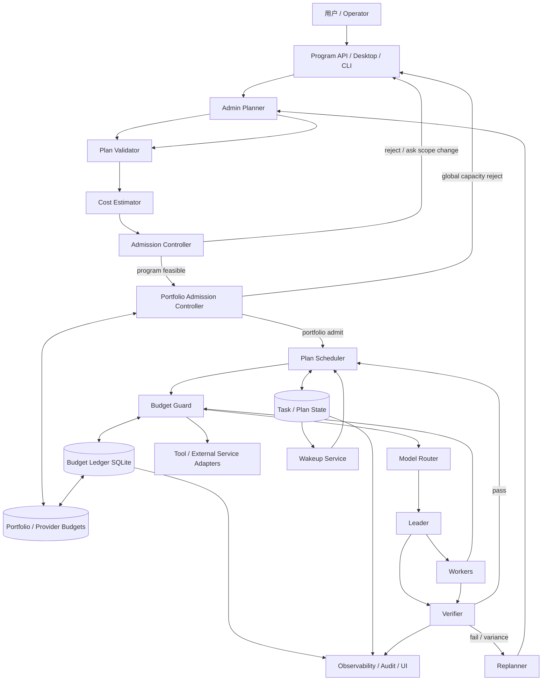

### 5.1 责任边界

| 组件 | 负责 | 不负责 |
| --- | --- | --- |
| Admin Planner | 语义拆解、范围层级、依赖、验收、排期候选 | 扣费、越权加预算、绕过准入 |
| Cost Estimator | 根据历史和当前上下文生成成本分布 | 决定业务范围 |
| Plan Validator | Schema、DAG、能力、验收和风险规则校验 | 执行任务 |
| Admission Controller | 选择最高可行层级，批准或拒绝计划 | 生成实现内容 |
| Portfolio Admission Controller | 检查跨 Program 预算、Provider 配额、Agent 容量和公平性 | 修改单个 Program 的业务范围 |
| Plan Scheduler | 依赖、优先级、唤醒、并发、租约 | 判断模型输出是否正确 |
| Budget Guard | 预留、结算、预算模式和硬阻断 | 语义规划 |
| Model Router | 在允许的模型集合中选择成本/质量方案 | 改变根预算 |
| Verifier | 对验收条件产生机器可检查证据 | 通过语言自评代替测试 |
| Replanner | 响应环境变化、估算偏差和失败 | 修改已经发生的账本事实 |
| Wakeup Service | 持久化定时唤醒和租约恢复 | 长时间保持 LLM 会话在线 |

## 6. 预算模型

### 6.1 多维预算向量

```ts
interface BudgetVector {
  moneyMicros?: number;
  inputTokens?: number;
  outputTokens?: number;
  modelCalls?: number;
  toolCalls?: number;
  externalUnits?: Record<string, number>;
}
```

每个维度独立实施上限。不能用“美元余额充足”覆盖“搜索次数已经耗尽”。比较、加减和预留操作必须逐维执行。

预算不是只有 Program 一层。多个单独可行的 Program 仍可能共同超出 Project、组织或 Provider 配额，因此账户层级必须是：

```text
organization / provider quota
  -> project portfolio budget
       -> program budget
            -> work package envelope
                 -> model/tool child reservation
```

Portfolio Admission Controller 在 Program 准入前检查全局金额、速率、并发槽位、Agent 日历、磁盘和 Provider 额度。全局 Scheduler 负责跨 Program 的公平性、优先级和防饥饿；Program 内 Scheduler 不能绕过 Portfolio reservation。

### 6.2 根预算分区

```ts
interface BudgetAllocation {
  planning: BudgetVector;
  minimumDelivery: BudgetVector;
  upgradePool: BudgetVector;
  validation: BudgetVector;
  contingency: BudgetVector;
  closeout: BudgetVector;
}
```

冷启动建议比例：

| 分区 | 建议值 | 是否可被普通执行使用 |
| --- | ---: | --- |
| 规划和重规划 | 5% | 仅 Planner/Replanner |
| 最小交付 | 50% | 是 |
| 标准/增强升级池 | 10% | minimum 闭环安全后使用 |
| 验证与集成 | 15% | 仅 Verifier/Release |
| 风险储备 | 15% | 需 Replanner 批准 |
| 最终收尾 | 5% | 仅 Closeout |

这些比例只是实验冷启动 floor，不是长期常量或强制切分。正式准入使用 `max(configuredFloor, bottomUpP95Estimate)` 保护 planning、validation 和 closeout，再把剩余预算分配给 minimum/upgrade。系统应按 `taskClass × model × agentRole × toolProfile` 校准；历史不足时进入 `uncalibrated` 并要求人工批准。

### 6.3 预算账户树

```text
program:<id>
├── planning
├── execution
│   ├── minimum
│   └── upgrade_pool
│       ├── standard
│       └── stretch
├── validation
├── contingency
└── closeout
```

父账户约束子账户总和。账户转账只能由确定性策略执行并产生审计事件。禁止 Agent 通过自然语言请求直接转账。

Work Package 信封和单次调用 reservation 是父子关系，不能在根账户重复冻结：

```text
Program execution available
  -> Work Package envelope reservation（冻结根账户额度）
       -> model/tool child reservation（只占用信封内部余额）
            -> settlement（信封 reserved 转为 Program spent）
       -> release unused envelope（释放尚未消费的差额）
```

根账户的 `active_reservations` 只统计 Work Package 信封及不属于 Work Package 的直属 reservation；子调用 reservation 用来防止同一信封内并发超卖，但不再次计入根账户，从而避免双重预留。

正式会计恒等式按每个预算维度分别成立：

```text
envelope.limit
  = envelope.spent + envelope.child_reserved + envelope.remaining

program.limit
  = program.spent
  + active_envelope_remaining
  + protected_remaining
  + program.available

portfolio.limit
  >= sum(program.spent + program.active_reserved + program.available_grant)
```

所有量必须非负。创建、结算、释放子 reservation 时，在同一个 `BEGIN IMMEDIATE` 事务内更新父信封并校验不变量；不能在应用层先读余额再异步写回。

### 6.4 Reservation 生命周期

```text
pending -> active -> settled
                  -> released
                  -> uncertain -> reconciled
pending -> rejected
active  -> expired -> reconciled
```

- `pending`：事务内创建，尚未向 Provider 发送。
- `active`：请求已发送或外部副作用可能发生。
- `settled`：收到可信 usage/receipt，按实际开销结算。
- `released`：确认没有产生消费。
- `uncertain`：请求结果未知，额度继续冻结，不能立即重试。
- `reconciled`：通过 Provider 查询、幂等重放或人工处理确认结果。

### 6.5 调用最大成本

模型调用预留：

```text
maxCost = promptTokensUpperBound × inputPrice
        + maxOutputTokens × outputPrice
        + cacheWriteUpperBound × cacheWritePrice
        + fixedRequestCost
```

工具调用必须在注册时声明：

```ts
interface MeteredToolPolicy {
  toolName: string;
  maximumCost(input: unknown): BudgetVector;
  idempotency: "native" | "adapter" | "none";
  receiptMode: "sync" | "poll" | "callback";
}
```

无法声明上界且不支持幂等的付费工具，不能用于硬预算 Program。

### 6.6 Provider 计费与恢复能力

Pricing Snapshot 用于复现估算，不自动等于 Provider 的最终账单。系统必须同时维护：

```text
contractual_usage_ledger  // Token、调用次数等可硬约束资源
estimated_money_ledger   // 调用前按价格上界预留
billed_money_ledger      // Provider 最终账单或可信回执
```

Provider Profile 必须声明：

BLH-003 的保守 Profile、证据等级和 hard-mode 判定见 [Provider Budget Capability Profile](./provider-budget-capability-profile.md)。

```ts
interface ProviderBudgetCapability {
  providerId: string;
  beforeEveryModelCallHook: boolean;
  supportsMaxOutputTokens: boolean;
  pricingUpperBoundTrusted: boolean;
  usageInResponse: boolean;
  idempotency: "native" | "adapter" | "none";
  recovery: "queryable_and_idempotent" | "idempotent_not_queryable" |
            "usage_queryable_only" | "non_recoverable";
  billingReconciliation: "api" | "statement" | "none";
}
```

只有 `beforeEveryModelCallHook=true`、支持输出上限且价格上界可信时，才允许对货币维度启用 `hard`。否则只能对 Token/调用次数进行硬限制，货币维度必须标记为估算。

对 `non_recoverable` 请求发生断连时：按 reservation 上界结算，将 Attempt 标记为 `lost_response`；只有剩余预算可以覆盖一次新调用时才允许重试，且不得声称模型执行 exactly-once。

## 7. 范围契约与完成定义

### 7.1 三层交付范围

```ts
interface ScopeTier {
  tier: "minimum" | "standard" | "stretch";
  objective: string;
  deliverables: DeliverableContract[];
  excluded: string[];
  degradationFrom?: "standard" | "stretch";
}

interface DeliverableContract {
  id: string;
  description: string;
  artifactType: "git" | "document" | "dataset" | "deployment" | "report";
  acceptanceCriteria: AcceptanceCriterion[];
  recoveryValue: string;
}
```

`minimum` 必须是完整纵向闭环，例如“能运行的单用户版本并通过核心测试”，而不能是“完成数据库层但没有 API/UI”。

范围降级是用户授权，不是系统自行推断。Budget Contract 必须包含：

```ts
interface DegradationPolicy {
  preapprovedTiers: Array<"minimum" | "standard" | "stretch">;
  requireApprovalBelow?: "standard" | "minimum";
  approvalTimeoutSeconds?: number;
  approvalTimeoutAction: "pause" | "closeout" | "continue_minimum";
}
```

- `shadow` 不执行降级；
- `soft` 只建议降级；
- `hard` 只能自动切换到 `preapprovedTiers`；
- 未获授权的降级必须暂停或 closeout；
- `completed_degraded` 必须明确显示最终交付层级，不能等同于原始范围成功。

### 7.2 Typed Acceptance Criteria

验收条件必须是结构化、版本化、可重复执行的规则，而不是自由文本：

```ts
type AcceptanceCriterion =
  | { type: "command_exit_zero"; command: string; timeoutSeconds: number }
  | { type: "file_exists"; path: string; digest?: string }
  | { type: "schema_valid"; artifact: string; schemaRef: string }
  | { type: "test_report"; path: string; minimumPassed: number; maximumFailed: number }
  | { type: "metric_threshold"; metric: string; operator: ">=" | "<="; value: number }
  | { type: "external_state"; adapter: string; predicate: string }
  | { type: "human_approval"; approvalPolicyId: string }
  | { type: "llm_judge"; rubricId: string; minimumScore: number; requiresCorroboration: true };
```

每次 Verification Run 保存验证器版本、固定产物 digest/Git SHA、输入、超时、退出状态和证据路径。`llm_judge` 不能单独证明高影响交付完成，必须由确定性检查或人工批准佐证。证据在依赖、基线、验收规则或验证器版本变化后必须失效并重新验证。

### 7.3 完成条件

Program 只有同时满足以下条件才进入 `completed`：

1. 当前承诺 Scope Tier 的全部 mandatory Work Package 完成；
2. 所有验收条件有可审计证据；
3. 没有未对账的预算 reservation；
4. 没有未确认的外部副作用；
5. 最终产物已写入交付清单；
6. Admin 已生成最终报告；
7. 若包含 Git 变更，已通过现有 Leader Review / Admin Release 流程。

Assistant 自称“完成”不是完成证据。

## 8. 规划模型

### 8.1 Budget Contract

```ts
interface BudgetContract {
  id: string;
  programId: string;
  hardLimit: BudgetVector;
  deadlineAt?: string;
  targetCompletionProbability: number; // 默认 0.90
  pricingSnapshotId: string;
  permittedModels: string[];
  permittedTools: string[];
  scopeTiers: ScopeTier[];
  degradationPolicy: DegradationPolicy;
  reservePolicy: ReservePolicy;
  requestedMode: "shadow" | "soft" | "hard";
  effectiveMode: "shadow" | "soft" | "hard";
  capabilityCheckId: string;
  createdAt: string;
}
```

根预算创建后不可原地增大。用户增加预算时创建 `BudgetAmendment`，保留旧值和授权链。

### 8.2 Plan Version

```ts
interface PlanVersion {
  id: string;
  programId: string;
  version: number;
  parentVersionId?: string;
  reason: "initial" | "checkpoint" | "failure" | "scope_change" | "deadline_change";
  selectedTier: "minimum" | "standard" | "stretch";
  workPackages: WorkPackage[];
  estimate: ProgramEstimate;
  feasibility: FeasibilityDecision;
  status: "draft" | "validated" | "admitted" | "superseded" | "rejected";
  createdBy: string;
  createdAt: string;
}
```

计划版本不可修改。重规划产生新版本；已完成 Work Package 通过稳定业务 ID 映射到新版本，避免重复执行。

### 8.3 Work Package

```ts
interface WorkPackage {
  id: string;
  stableKey: string;
  programId: string;
  planVersionId: string;
  parentId?: string;
  targetAgentRole: "admin" | "leader" | "worker";
  targetTeam?: string;
  dependsOn: string[];
  conflictKeys: string[];

  title: string;
  prompt: string;
  scopeTier: "minimum" | "standard" | "stretch";
  mandatory: boolean;
  acceptanceCriteria: AcceptanceCriterion[];

  notBefore?: string;
  deadlineAt?: string;
  estimatedDurationSeconds: CostInterval;
  estimatedBudget: BudgetDistribution;
  hardEnvelope: BudgetVector;
  checkpointPolicy: CheckpointPolicy;
  retryPolicy: RetryPolicy;
  modelPolicyId: string;

  status: WorkPackageStatus;
}
```

Work Package 必须满足：

- 至少一个可检查验收条件；
- 明确最大预算信封；
- 默认能在单次有界 Agent Turn 中完成；
- 预计超过单次 Turn 上限时必须进一步拆分；
- 不允许用“继续直到做好”为 Prompt；
- 并行包必须显式声明没有共享写冲突，或使用冲突锁串行化。

## 9. 成本估算与校准

### 9.1 数据来源

估算器按优先级组合：

1. 相同 `stableKey` 的历史 Attempt；
2. 相同任务类别、模型、角色和工具组合；
3. 相似 Work Package 的检索结果；
4. 静态特征：Prompt 长度、文件数量、代码规模、验收数量、依赖深度；
5. Admin/Leader 的区间估计；
6. 冷启动保守规则。

Agent 自估只能作为特征，不能直接成为批准额度。

### 9.2 分布而不是点估计

```ts
interface CostInterval {
  p50: number;
  p80: number;
  p90: number;
  p95: number;
  hardMax: number;
}

interface BudgetDistribution {
  dimensions: Record<keyof BudgetVector, CostInterval>;
  confidence: number;
  sampleSize: number;
  estimatorVersion: string;
}
```

冷启动时建议：

- 使用类比任务中位数作为 P50；
- 以 P50 的 1.8–2.5 倍作为 P90，具体倍数按任务类别配置；
- 重试和验证单独建模，不能埋在统一倍率内；
- 首次接入的新模型和新工具使用更高不确定性。

### 9.3 在线校准

每个 Attempt 结束后记录：

```text
estimate_p50 / p90 / hard_max
actual_cost
task_class / model / role / tools
success / retry / failure_class
context_size / changed_files / test_count
```

按滑动窗口计算：

- P50/P90 覆盖率；
- 估算偏差；
- 分组样本数；
- 超过 hardMax 的次数；
- 失败和返工导致的额外成本。

当某组 P90 实际覆盖率低于目标时，自动扩大安全系数；恢复收缩必须缓慢，避免短期幸运样本使预算过于激进。

### 9.4 Program 可行性

对每个 Scope Tier 进行带相关性的 Monte Carlo：

```text
sampleCost = planning
           + critical mandatory packages
           + validation
           + retry/failure samples
           + closeout

sampleSuccess =
  allBudgetDimensionsWithinLimit
  AND sampleFinish <= deadline
  AND mandatoryAcceptancePassed

feasible(tier) = P(sampleSuccess) >= targetProbability
```

该概率是联合约束，不能分别计算“成本达标 90%”和“期限达标 90%”后声称整体为 90%。金额、输入/输出 Token、工具次数、截止时间和最小验收必须在同一个 Monte Carlo 样本中同时满足。

共享依赖、同一未知技术和同一 Provider 故障应共享风险因子，不能假定所有 Work Package 独立。样本不足、分布漂移或无法校准时，估算器返回 `uncalibrated`，不得展示精确完成概率；Admission Controller 使用保守上界并要求人工批准，或拒绝进入 `hard`。

Admission Controller 选择最高可行 Tier；如果 `minimum` 不可行则拒绝启动。

## 10. 调度与执行策略

### 10.1 Program 状态机

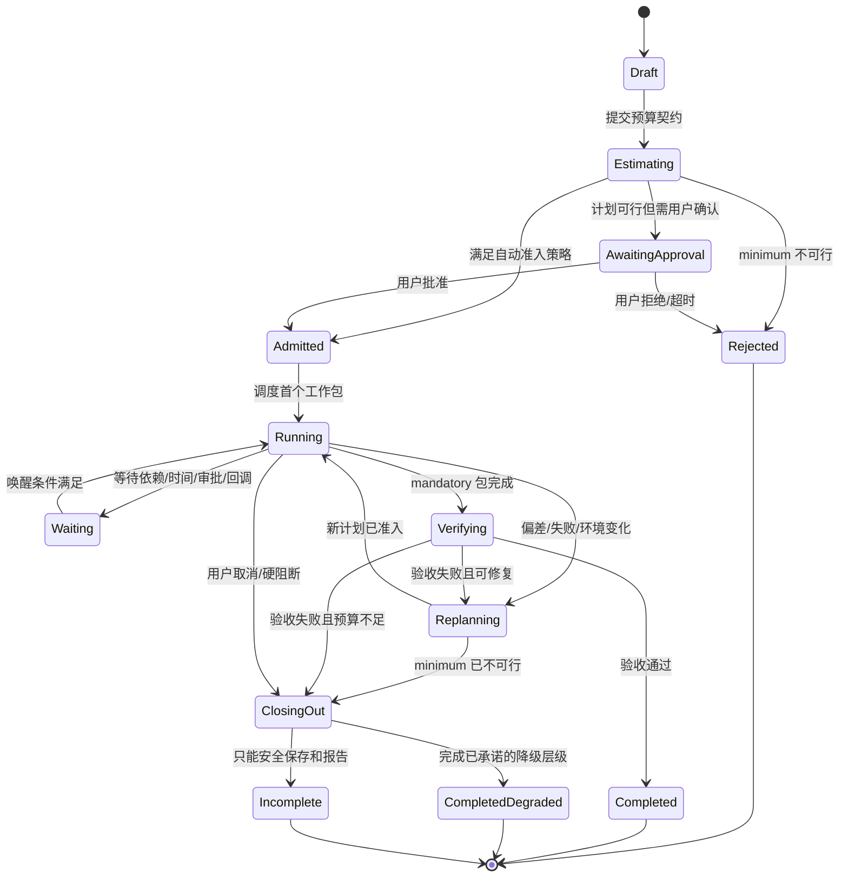

`Incomplete` 是异常结果，必须保留未完成原因、可恢复点和已消费预算；系统不能把它伪装成成功。

### 10.2 Work Package 状态机

```text
planned
  -> blocked_dependency
  -> scheduled
  -> reserving
  -> running
  -> checkpointed
  -> verifying
  -> completed

running/checkpointed/verifying
  -> retry_wait
  -> replanning
  -> cancelled
  -> failed

running -> uncertain_effect -> reconciling -> running/completed/failed
```

### 10.3 Runnable 判定

工作包只有同时满足以下条件才能进入队列：

1. Program 为 `running`；
2. 当前 Plan Version 为 active；
3. `notBefore <= now`；
4. 所有依赖已完成并通过验收；
5. conflict key 未被其他 Attempt 持有；
6. 目标 Agent 存在且健康；
7. 并发配额允许；
8. Work Package 硬信封可被完整预留；
9. 执行后仍保留 validation 和 closeout 预算；
10. 当前 Budget Mode 允许该 Scope Tier。

### 10.4 Budget Mode

```ts
type BudgetMode = "explore" | "balanced" | "commit" | "closeout";
```

| 模式 | 允许行为 |
| --- | --- |
| explore | 小规模并行探索、候选方案比较、强模型诊断 |
| balanced | 正常实现，限制重复采样和无验收价值的调用 |
| commit | 禁止新增可选范围，优先单路径实现、测试和集成 |
| closeout | 仅允许验证、保存、打包、对账和最终报告 |

模式由剩余预算对剩余必需成本的覆盖率决定，而不是只看已消费百分比：

```text
free = limit - spent - activeReservations - protectedReserves
health = free / P90(requiredRemaining)

health >= 1.50  -> explore（还需满足风险策略）
1.20..1.50      -> balanced
1.00..1.20      -> commit
health < 1.00   -> 降级 Tier 或 closeout
```

阈值应配置化并由历史数据调整。

## 11. 持久化设计

### 11.1 数据库位置

建议在 Project state directory 下新增：

```text
<runtime.persistence.state_dir>/execution/execution.db
```

BLH-005 启动器的落地说明见 [Execution DB 启动器](./execution-database-bootstrap.md)。

预算 Program 不能以 scheduler JSON 和 SQLite 作为双事实源。首个可执行版本即把 Program、Plan、Work Package、Attempt、Queue、Lease、Reservation 和 Outbox 统一写入 execution DB；现有 scheduler JSON 只负责未启用实验功能的普通短任务。实验 Program 的 Task board 项是 SQLite 状态的只读投影，不反向决定执行状态。

现有普通 Task 若需要转为 Program，必须通过显式迁移事务创建新的 Work Package 和预算账户；不能在两个 Scheduler 间自动双写。这样才能保证“任务接受、预算冻结和入队”在一个 SQLite 事务内完成。

SQLite 设置：

```text
PRAGMA journal_mode = WAL;
PRAGMA foreign_keys = ON;
PRAGMA busy_timeout = 5000;
PRAGMA synchronous = FULL;  // reservation、settlement、副作用回执事务
```

### 11.2 主要数据表

BLH-006 已实现的基础表与原子迁移协议见 [Execution Schema v1](./execution-schema-v1.md)；下列完整表集仍包含后续任务目标。
BLH-008～010 已实现的 revision CAS、Transactional Outbox、投递租约和 append-only 审计协议见 [Execution Repository、Transactional Outbox 与审计存储](./execution-repositories-outbox-audit.md)。这些能力仍受默认关闭的实验父开关约束。
BLH-011～020 已实现的安全整数账本、Reservation/Settlement、Pricing Snapshot、Runtime Context、Shadow Guard、Usage Reconciler、历史基线和 Program 草案边界见 [预算账本、运行时上下文与 Program 草案](./budget-ledger-runtime-program.md)。
BLH-021～030 已实现的类型化验收、联合准入、Tier 选择、原子激活、确定性调度、Lease/Fencing、持久化 Wakeup 与单向 Task Board 投影见 [计划、准入、调度与长期运行基础](./planning-admission-scheduling-runtime.md)。

专项回归后，实验父开关启用时会启动 `ProgramExecutionCoordinator`：每 10 秒扫描持久化 Wakeup，经专用 Outbox 消费者对 `admitted/running/waiting` Program 做确定性 tick，将计划选择、非保护预算分区 Reservation、Attempt Lease/Fencing 与现有 TaskManager 队列连接起来；Task Prompt 携带运行时上下文，父进程在发送 Prompt、执行 Tool 和调用模型前再次校验 barrier、epoch、租约 owner/expiry、fencing token 和 Reservation。活跃及 ReviewPending 任务会续租，队列失败会补偿释放，租约过期会转为 `uncertain/replanning_required`。批准定义内的有限重试/重规划、配置式模型路由以及停止/恢复点/对账/报告的收尾流程已接入，详见[运行时说明](./replanning-routing-closeout-runtime.md)。Task Completed 后进入 `verifying`，首批确定性验证器通过后才能完成工作包、推进依赖和触发活动计划 Closeout。SDK 模型续轮已接入独立子 Reservation、Usage 回报结算和未知结果保守对账；Provider 权威计费与身份、其他验收 Adapter 和真实远端恢复演练仍待补齐；共享 SQLite 跨实例调度及竞争回归已接入，见[协调协议](./cross-instance-scheduling-runtime.md)；Wakeup 的重启补发、暂停延期及旧 epoch 隔离已接入，不能据此开放 Hard。详情见[模型调用计量与自动验收运行时](./model-metering-verification-runtime.md)。
BLH-031～040 已实现的 Checkpoint、Execution Barrier、中止/快照/恢复、迟到事件隔离、Effect Ledger 与 Tool Guard 见 [Checkpoint、中止恢复与外部副作用安全](./checkpoint-interrupt-effects-runtime.md)。

```text
programs
portfolio_budgets
portfolio_grants
provider_budget_capabilities
budget_contracts
budget_amendments
pricing_snapshots
budget_accounts
budget_transfers
budget_reservations
spend_events
billing_reconciliations
plan_versions
work_packages
work_package_dependencies
work_package_attempts
attempt_leases
execution_checkpoints
suspension_snapshots
program_control_requests
acceptance_criteria
verification_runs
side_effect_receipts
wakeups
replan_requests
estimation_observations
execution_outbox
audit_events
```

### 11.3 关键表约束

```sql
-- 概念性结构，最终迁移以实际 SQL 为准。
budget_reservations(
  id TEXT PRIMARY KEY,
  program_id TEXT NOT NULL,
  account_id TEXT NOT NULL,
  parent_reservation_id TEXT,
  attempt_id TEXT NOT NULL,
  operation_key TEXT NOT NULL UNIQUE,
  state TEXT NOT NULL,
  reserved_json TEXT NOT NULL,
  settled_json TEXT,
  remaining_json TEXT NOT NULL,
  version INTEGER NOT NULL DEFAULT 0,
  provider_request_id TEXT,
  expires_at TEXT,
  created_at TEXT NOT NULL,
  updated_at TEXT NOT NULL
);

spend_events(
  id TEXT PRIMARY KEY,
  reservation_id TEXT NOT NULL,
  source_event_id TEXT NOT NULL UNIQUE,
  actual_json TEXT NOT NULL,
  pricing_snapshot_id TEXT NOT NULL,
  created_at TEXT NOT NULL
);

side_effect_receipts(
  id TEXT PRIMARY KEY,
  operation_key TEXT NOT NULL UNIQUE,
  tool_name TEXT NOT NULL,
  external_id TEXT,
  request_digest TEXT NOT NULL,
  state TEXT NOT NULL,
  receipt_json TEXT,
  created_at TEXT NOT NULL,
  updated_at TEXT NOT NULL
);
```

所有金额用整数微单位，禁止浮点数。Token 和调用次数使用非负整数。所有 JSON 字段进入业务层前必须经过严格 Schema 校验。

正式迁移必须把 BudgetVector 拆成可索引整数列或维护同一事务内的逐维汇总表；不能只依赖 JSON 应用层校验。至少为金额、输入 Token、输出 Token、模型调用和工具调用建立非负约束。父 reservation 外键、账户层级、Program 归属和 version CAS 必须由数据库约束保护。

### 11.4 事务边界

下列操作必须各自在单个 SQLite 事务中完成：

- 创建 reservation 并扣减 available；
- settlement 写入 spend event、更新 spent 并释放 reservation 差额；
- Work Package 完成与下一依赖可运行事件写入 Outbox；
- side effect receipt 与 Attempt 状态变更；
- Plan Version 准入与 active version 指针切换；
- lease 领取与 Attempt 转为 running。
- `controlRequestId` 去重、Program 状态转为 `interrupt_requested`、递增 execution epoch 和写 Outbox；
- Suspension Snapshot 元数据、内容 digest 与 Program 转为 `suspended/suspended_uncertain`。

发送模型请求无法与本地数据库构成分布式事务，因此通过 `operationKey + reservation + providerRequestId + reconciliation` 处理不确定窗口。

### 11.5 数据生命周期与灾难恢复

数月运行需要定义数据库本身的预算和恢复：

- 周期性 WAL checkpoint，并监控 WAL/DB/工件磁盘占用；
- execution DB 原子备份、备份校验和恢复演练；
- Schema migration 使用可恢复阶段和 `PRAGMA user_version`；
- 磁盘低于安全阈值时停止新 Program，只允许 closeout；
- Spend Event、Budget Amendment 和高影响副作用审计按合规策略保留，不随普通日志清理；
- Prompt、模型响应和工具回执分别配置保留期并在持久化前脱敏；
- 数据库损坏时 fail closed，禁止仅凭 Task board 投影恢复消费；
- 时间统一保存 UTC，排期输入保留原始时区；检测系统时钟回拨，lease 使用数据库时间和单调持续时间辅助判断。

## 12. Continuation State 与检查点

```ts
interface ExecutionCheckpoint {
  id: string;
  programId: string;
  workPackageId: string;
  attemptId: string;
  planVersionId: string;
  sequence: number;

  verifiedArtifacts: Array<{
    path: string;
    digest?: string;
    gitSha?: string;
  }>;
  completedCriteria: string[];
  pendingCriteria: string[];
  decisions: Array<{ key: string; value: string; evidence: string[] }>;
  externalReceipts: string[];
  activeReservations: string[];
  nextAction: string;
  reobserve: string[];
  createdAt: string;
}
```

检查点只保存恢复所需状态。完整模型对话可以保留作审计，但恢复不能依赖重放对话，因为环境和模型输出都可能变化。

触发检查点：

- 每个 Work Package 开始和结束；
- 每次不可逆副作用前后；
- 达到该包预算的 25% 或配置阈值；
- Agent 主动报告阶段进度；
- 即将等待人工审批、远端回调或未来时间；
- 发生模型切换、重规划或上下文压缩；
- Orchestrator 正常停机。

## 13. 长期唤醒、租约与并发

### 13.1 Wakeup Service

不要为数月后的任务创建单个长 `setTimeout`。持久化 `wakeups` 表并定期扫描：

```text
SELECT ... FROM wakeups
WHERE state = 'pending' AND wake_at <= now
ORDER BY wake_at, priority
LIMIT N;
```

建议扫描周期 30–60 秒；应用启动时立即扫描一次。唤醒项通过唯一 `dedupe_key` 保证重复扫描安全。

### 13.2 Attempt Lease

```ts
interface AttemptLease {
  attemptId: string;
  ownerInstanceId: string;
  fencingToken: number;
  acquiredAt: string;
  heartbeatAt: string;
  expiresAt: string;
}
```

只有持有最新 fencing token 的实例可以写入 Attempt 结果。长工具调用期间按固定间隔续租；失去租约后只能停止本地工作，不能提交结果。

### 13.3 并发约束

并行不是免费加速。每个 Program 设置：

- 最大并行 Work Package 数；
- 最大并行强模型调用数；
- Team/Agent 并发上限；
- 每个 Provider 的速率和突发上限；
- 同一 conflict key 的互斥锁；
- 每日/每小时消费节奏上限。

并行准入要计算协调成本和合并/评审预算。重复让多个 Worker 实现同一任务默认禁止，除非计划显式声明候选比较价值和选择器。

### 13.4 DAG 排期算法

Admin 提供业务依赖和期望时间窗，Scheduler 负责生成满足资源约束的实际排期。首期采用可解释的 Resource-Constrained Project Scheduling：

1. 使用 Work Package 的 P90 时长对 mandatory DAG 做前向/后向遍历；
2. 计算最早开始、最晚开始、总时差和关键路径；
3. 将 Agent 数、Team 并发、Provider 限流、冲突锁和预算节奏作为资源约束；
4. 使用串行排程生成方案，每次从 eligible 集合选择优先级最高的包；
5. 在每个检查点、失败、范围变化和资源变化后增量重排；
6. 不改变已开始 Attempt 的归属，除非安全暂停并创建新 Attempt。

建议优先级按字典序而非不可解释的单一分数处理：

```text
mandatory scope 优先
-> 关键路径/更小 slack 优先
-> 能解锁更多后继包者优先
-> 更早 deadline 优先
-> 已等待更久者优先
-> 在上述相同条件下，较低 P90 成本者优先
```

如果需要统一分数，可将各项归一化后配置权重，但必须在审计事件中保存各分量，避免只记录一个无法解释的数字。

### 13.5 消费节奏控制

仅有总预算仍可能在第一天过度探索。每个 Plan Version 应根据排期生成累计 P50/P90 消费曲线：

```text
plannedSpendP90(t) = 截止时间 t 前计划启动的包、验证和风险暴露的累计 P90
paceHeadroom(t) = configuredBurst + 提前完成释放的额度
actualSpend(t) + activeReservations(t)
  <= plannedSpendP90(t) + paceHeadroom(t)
```

- `explore` 可以使用有限 burst；
- `balanced` 不能持续超过 P90 曲线；
- `commit` 只允许关键路径和必要验证消费；
- 未使用的日/周额度可以滚入未来，但不能解除 closeout/validation 保护；
- 截止时间临近时，Scheduler 可以把未来额度前移给关键路径，但必须重新验证剩余 Program 可行性。

这种节奏控制防止长达数月的 Program 在早期把预算消耗在低价值探索上。

## 14. 模型路由

```ts
interface ModelPolicy {
  id: string;
  allowed: Array<{
    model: string;
    roles: string[];
    maxCostPerCall: BudgetVector;
    capabilityTags: string[];
  }>;
  escalationRules: EscalationRule[];
  downgradeRules: DowngradeRule[];
}
```

路由输入包括：

- Work Package 类型和难度；
- 当前 Budget Mode；
- 剩余预算与 P90 剩余成本；
- 前一次失败类别；
- 是否需要工具、长上下文或多模态；
- 模型在相同任务类别上的历史成功率与成本。

首期使用规则路由：

1. 格式化、摘要、分类和简单修改使用低成本模型；
2. 初始计划、架构权衡和困难故障允许强模型；
3. 强模型升级必须有失败证据或高价值理由；
4. `commit` 模式禁止无验收目标的多样化采样；
5. `closeout` 模式只使用完成验证和报告所需模型。

后续可用历史轨迹训练路由器，但必须保留硬 Budget Guard。

### 14.1 Runtime 调用级拦截前置条件

当前 OAT 父进程向 Agent Runner 发送的是一次 `session.prompt()`，工具调用后的模型续轮由 `pi-coding-agent` Session 内部发起。只在 `TaskManager.sendManagedPrompt()` 前预留整个 Turn，无法实现逐次调用路由和精确硬门控。

实现前必须完成 Runtime Spike，验证或增加以下接口：

```ts
interface MeteredModelRuntime {
  beforeModelCall(request: ModelCallRequest): Promise<{
    reservationId: string;
    model: string;
    maxOutputTokens: number;
  }>;
  afterModelCall(result: ModelCallResult): Promise<void>;
  onModelCallUncertain(error: unknown): Promise<void>;
}
```

该 Hook 必须覆盖首次生成、工具调用后的自动 continuation、重试、压缩/摘要调用和任何 SDK 内部模型调用。若上游 SDK 没有稳定扩展点，应在 Provider transport 层增加 OAT Metering Proxy，而不是依赖 `message_end` 事后扣费。

能力预检规则：

- 没有逐调用 Hook：最高只能 `soft`；
- 无法设置最大输出：该模型不能用于 `hard`；
- 无法确定实际调用模型：禁止调用级路由和货币硬保证；
- usage 只在最终消息聚合返回：只能做 Turn 级保守预留；
- 自定义兼容 Provider 的价格为零或未知：货币维度不得进入 `hard`。

## 15. 重规划与范围降级

### 15.1 重规划触发器

- Work Package 实际成本超过 P90；
- 预计 Program 剩余成本超过可用预算；
- 关键路径预计超过截止时间；
- 验收失败；
- 连续两次相同失败；
- 外部依赖、需求或代码基线发生变化；
- Provider 不可用或模型价格变化；
- 用户改变范围、期限或预算；
- 当前 Plan Version 存在无法满足的依赖。

### 15.2 决策顺序

Replanner 必须按固定顺序处理，不允许直接请求更多预算：

1. 取消尚未开始的 `stretch` 包；
2. 取消尚未开始的 `standard` 可选包；
3. 减少并行候选、搜索深度和重复采样；
4. 路由到更低成本模型；
5. 复用已有产物、缓存和验证证据；
6. 从 contingency 转移经过批准的额度；
7. 切换到更低 Scope Tier；
8. 如果 minimum 仍不可行，进入 closeout；
9. 只有用户明确授权后才创建 Budget Amendment。

### 15.3 已完成工作的继承

新计划通过 `stableKey` 和产物 digest 继承已经完成且仍有效的 Work Package。以下情况必须重新验证：

- 依赖版本变化；
- 验收标准变化；
- Git 基线改变且影响相关文件；
- 产物 digest 不匹配；
- 原验证器版本存在已知缺陷。

## 16. 人工中止、快照与恢复

长程 Program 必须允许用户随时停止 Agent 执行并保存可恢复状态。该能力属于控制面安全功能，即使实验预算功能处于 `shadow/soft`，只要 Program 功能已启用也必须可用；不得依赖剩余模型预算，也不得等待 Admin 自行理解并执行自然语言。

### 16.1 三种不同操作语义

| 操作 | 用户意图 | 在途 Agent | 后续恢复 |
| --- | --- | --- | --- |
| `pause_gracefully` | 在最近安全边界暂停 | 请求 Agent 在短宽限期内提交检查点，再中止 | 默认允许 |
| `interrupt_now` | 立即停止，优先控制风险 | 立即撤销租约并调用 Runtime abort；结果可能不完整 | 对账后允许 |
| `cancel_and_closeout` | 不再继续目标 | 阻止新工作，终止在途执行，转入 closeout | 默认不恢复，需显式 reopen |

UI 文案必须避免用一个含糊的“终止”同时表达三种语义。任务页面至少提供：

- 主操作：**暂停并保存**；
- 危险操作：**立即中止**；
- Program 菜单：**取消并收尾**。

### 16.2 双控制入口

#### 控制面按钮

按钮直接调用 Program Control API，是最可靠、最高优先级的入口：

- 不经过 Admin LLM；
- 不进入普通任务 FIFO；
- 即使 Admin、Leader 或 Worker 正忙也能立即处理；
- 使用幂等 `controlRequestId`；
- 显示中止进度、未停止 Agent、在途调用和对账状态；
- `interrupt_now` 和 `cancel_and_closeout` 需要确认，但不能要求模型参与确认。

#### 向 Admin 发送消息

用户也可以向 Admin 发送“暂停当前 Program 并保存快照”等消息，但必须区分：

1. Desktop/CLI 附带结构化 `controlIntent=interrupt_program` 时，由控制面直接执行，并把自然语言作为 reason；
2. 纯自由文本只由 Admin 解释并调用 `oat-program-interrupt`，因此不提供即时停止保证；
3. UI 应在检测到可能的停止意图时提供明确动作按钮，让用户确认并转为结构化控制请求；
4. Admin 工具和按钮最终调用同一个 Program Control Service，不能各自实现一套停止逻辑。

### 16.3 中止状态机

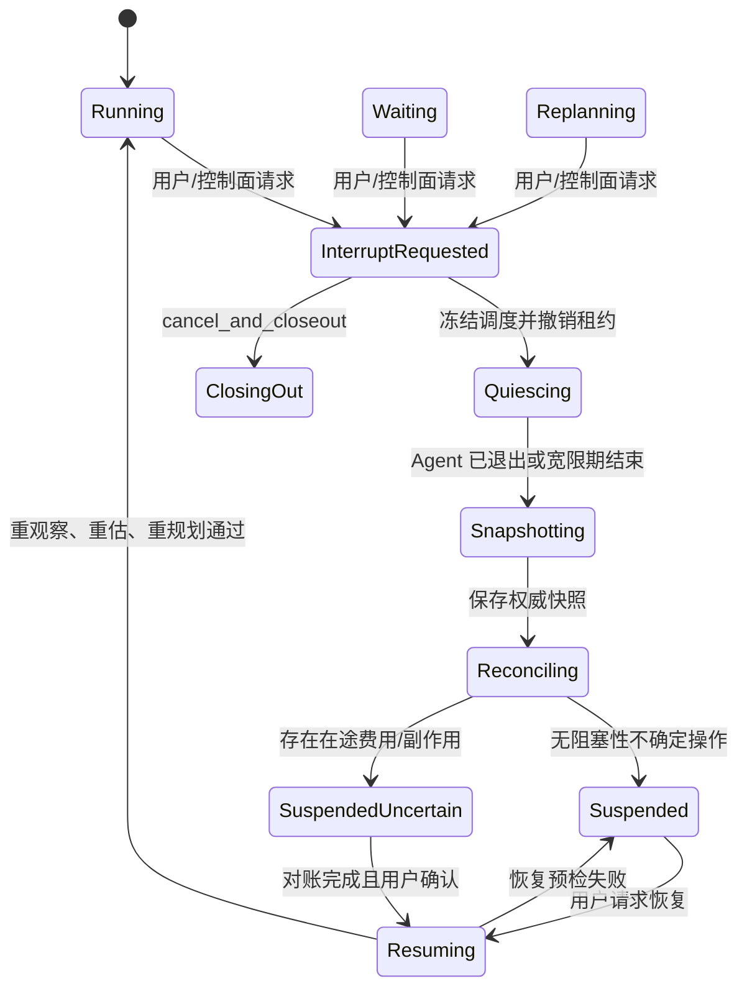

### 16.4 中止协议

Program Control Service 按以下顺序执行：

1. 验证本地可信用户权限、Program revision 和 `controlRequestId`；
2. 在 execution DB 单事务写入 `interrupt_requested`，递增 `execution_epoch`；
3. 禁止新的 Work Package、Wakeup、重试、模型调用和工具调用；
4. 撤销所有 Attempt lease，更新 fencing token，使旧执行者不能提交新结果；
5. 对 `pause_gracefully` 向运行 Agent 发送高优先级 cooperative checkpoint 请求；
6. 等待配置化宽限期，默认 10 秒；`interrupt_now` 跳过等待；
7. 调用 Runtime `abortAttempt()`，而不是停止整个 Orchestrator；
8. 等待 Runtime 确认结束；超时后终止对应 Agent Session/子进程或容器；
9. 采集工作区、Git、产物和最新确定性状态；
10. 将已发送但无结果的模型/工具调用标为 `uncertain`，冻结 reservation；
11. 对高影响外部副作用启动 Reconciler，不能假装它们已经取消；
12. 写入中止后权威快照，再将 Program 设为 `suspended` 或 `suspended_uncertain`。

必须先冻结和静默执行者，再生成权威快照。中止请求刚到达时可以保存一个 `pre_interrupt` 快照用于取证，但它不是恢复起点，因为旧 Agent 仍可能继续写入。

### 16.5 Runtime 中止接口

当前 `sendPrompt()` 只负责提交 Prompt，普通 Task 也只能在 queued 状态暂停。实验 Program 需要独立 Runtime 能力：

```ts
interface InterruptibleRuntimeProvider {
  requestCheckpoint(agentId: string, attemptId: string, deadlineAt: string): Promise<void>;
  abortAttempt(agentId: string, attemptId: string, reason: string): Promise<{
    acknowledged: boolean;
    providerRequests: string[];
    toolCalls: string[];
  }>;
  terminateSession(agentId: string, reason: string): Promise<void>;
}
```

首选调用 Agent Session 的原生 `abort()`，以保留进程和已加载资源；只有 abort 超时或 Runtime 不支持时才销毁 Session。重新使用已中止 Session 前必须 reset，防止迟到事件污染新 Attempt。

任何迟到的 `message_end`、tool result 或 usage 仍可以进入账本对账，但只有匹配当前 `execution_epoch + fencingToken` 的结果才能推进 Work Package 状态。

### 16.6 Suspension Snapshot

```ts
interface SuspensionSnapshot {
  id: string;
  programId: string;
  planVersionId: string;
  executionEpoch: number;
  reason: string;
  mode: "graceful" | "immediate" | "cancel_closeout";

  programRevision: number;
  budgetStateDigest: string;
  activeReservations: string[];
  uncertainOperations: string[];

  workPackages: Array<{
    id: string;
    stableKey: string;
    status: string;
    attemptId?: string;
    fencingToken?: number;
    latestCheckpointId?: string;
  }>;

  artifacts: Array<{
    path: string;
    digest?: string;
    gitSha?: string;
    verified: boolean;
  }>;
  workspaceStates: Array<{
    agentId: string;
    workspacePath: string;
    headSha?: string;
    dirty: boolean;
    patchArtifactPath?: string;
  }>;

  wakeups: string[];
  externalReceipts: string[];
  pendingApprovals: string[];
  resumePreconditions: string[];
  createdAt: string;
}
```

快照保存引用和 digest，不把整个工作目录塞入数据库。未提交改动应生成受控 patch/bundle 工件；秘密文件、凭据和被忽略文件不得自动打包。

停止和保存快照是控制面操作，不得因为 Program 模型预算耗尽而被拒绝。纯本地状态保存使用系统运维额度；需要付费 Provider 查询的对账可以延迟，但 Program 必须保持 `suspended_uncertain`，相关 reservation 继续冻结。

### 16.7 恢复协议

恢复不是继续旧对话，而是创建新的执行 epoch：

1. 用户选择 Suspension Snapshot，并可附加新的目标说明；
2. 校验快照、数据库 revision、Git SHA、工作区和产物 digest；
3. 完成或显式接受所有阻塞性 `uncertain` 对账；
4. 重新观察代码、外部系统、Provider 能力、价格和当前时间；
5. 使过期的验收证据和计划假设失效；
6. 重新计算预算、期限和 Portfolio 可行性；
7. 必要时生成新 Plan Version，并要求范围/预算授权；
8. 递增 `execution_epoch`，为未完成包创建新 Attempt 和新 fencing token；
9. reset/recreate Agent Session，只注入受限 Continuation State；
10. 用户确认后重新开启 Wakeup 和调度。

默认只允许用户手动恢复。进程崩溃后的自动恢复策略可以单独配置，但存在高影响副作用、未知费用、人工审批或过期计划时必须人工确认。

### 16.8 API、工具和事件

```text
POST /programs/:id/interrupt
  { controlRequestId, mode: "graceful" | "immediate" | "cancel_closeout",
    reason, expectedRevision }

GET  /programs/:id/interrupt-status
POST /programs/:id/resume
  { controlRequestId, snapshotId, message?, expectedRevision }
```

Admin 工具：

```text
oat-program-interrupt
oat-program-resume-request
```

审计事件：

```text
program.interrupt.requested
program.interrupt.quiescing
program.interrupt.runtime_aborted
program.interrupt.snapshot_created
program.suspended
program.suspended_uncertain
program.resume.requested
program.resume.preflight_failed
program.resumed
late_event.ignored_for_state
late_event.applied_to_ledger
```

### 16.9 补充审计边界

中止与恢复还必须明确以下容易遗漏的边界：

- **作用域**：控制请求必须声明 `program`、`work_package` 或 `agent_attempt`；产品首版只开放 Program 级停止，避免用户以为停止一个界面卡片就停止了全部并行 Worker。
- **多实例传播**：Execution Barrier 通过 execution DB revision/Outbox 广播；每个 Scheduler 和 Runtime 在发起模型或工具调用前重新校验 epoch，不能只依赖内存事件。
- **不可逆行为**：中止不会撤销已发送邮件、付款、发布或已产生的 Provider 费用；UI 必须展示“停止计算”和“撤销外部效果”是两件事。
- **进程树清理**：Session 终止要覆盖子进程、容器 exec、PTY 和仍持有文件锁的工具进程，同时保留诊断信息；不能只把 Task 状态改为 paused。
- **快照安全**：Snapshot manifest 必须有 Schema version、内容 digest、创建者、加密/密钥版本和保留策略；恢复前验证完整性与迁移兼容性，不兼容时只允许导出或人工迁移。
- **存储失败**：execution DB 或 Snapshot Store 不可写时，仍要尽力撤销 lease 和 abort Runtime，但状态显示 `interrupt_failed_storage`，不得谎报“已保存可恢复快照”。
- **控制权限**：按钮和 Admin 工具共享同一权限检查；紧急中止可比恢复权限更宽，但恢复、reopen 和接受未知副作用风险必须单独授权。
- **恢复验证**：恢复前提供 dry-run 报告，列出 Git/文件/价格/时间/Provider/权限漂移和将要重新执行的 Work Package；用户确认的是该报告，而非旧快照本身。

这些能力仍受父级实验开关控制。`budgetExecution.enabled=false` 时不注册 Program 中止/恢复 API、Admin 工具或 UI 控件；一旦实验 Program 已运行，中止与本地快照属于安全控制面，不再设置可被单独关闭的子开关，避免出现“能启动但不能停”的配置。

## 17. 外部副作用安全

所有会修改外部世界的工具调用必须使用 Effect Ledger：

```text
prepare -> reserved -> dispatched -> confirmed
                              \-> uncertain -> reconciled
prepare/reserved -> cancelled
```

每个操作生成稳定 `operationKey`：

```text
programId/workPackageStableKey/effectType/logicalSequence
```

适配器优先将其作为 Provider idempotency key。若 Provider 不支持：

- 调用前保存请求 digest；
- 超时后先查询外部状态；
- 无法确认结果时进入 `uncertain`，禁止自动重试；
- 必须由 reconciliation 或人工确认解除。

Effect Guard 在真正发送外部请求之前还必须校验 Attempt 的最新 fencing token。数据库拒绝旧 token 只能阻止旧 Worker 写回，不能阻止其继续修改外部世界；因此所有受管副作用都必须经由能够校验 fencing token 的 OAT Adapter/Proxy。无法经过 Guard 的高影响工具不允许在无人值守的 `hard` Program 中使用。

Provider 不支持查询时，Reconciler 不能假设可以恢复响应：`non_recoverable` 操作按最大成本结算并标记 `lost_response`；后续重试是一个新的、再次计费的 Attempt。只有外部系统提供幂等键或可查询回执时，才允许报告 exactly-once effect。

删除数据、付款、发送消息和发布版本等高影响操作仍需遵守现有人工授权策略；预算充足不等于获得副作用权限。

## 18. API 与 Agent 工具

### 18.1 Program API

以下写接口仅在 `budgetExecution.enabled=true` 时注册；disabled 状态只通过通用实验功能状态接口报告 `feature-disabled`，`/programs` 写路由本身不存在，也绝不能隐式创建普通 Task。shadow/soft/hard 的响应都必须包含 `requestedMode`、`effectiveMode` 和 `hardGuaranteeActive`。

| 方法 | 路径 | 用途 |
| --- | --- | --- |
| `GET` | `/experimental-features/budget-execution` | 始终可用；返回 enabled/requested/effective mode、能力预检和保证边界 |
| `POST` | `/programs` | 创建目标和 Budget Contract 草案 |
| `GET` | `/programs/:id` | Program、计划、预算和进度快照 |
| `POST` | `/programs/:id/plan` | 请求 Admin 生成新 Plan Version |
| `POST` | `/programs/:id/admit` | 验证并准入计划 |
| `POST` | `/programs/:id/approve` | 用户批准需要确认的计划 |
| `POST` | `/programs/:id/interrupt` | 直接进入 graceful/immediate/cancel_closeout 控制协议；不经过 Admin LLM |
| `GET` | `/programs/:id/interrupt-status` | 查询静默、Runtime 中止、快照和对账进度 |
| `POST` | `/programs/:id/resume` | 从指定 Suspension Snapshot 对账、预检并恢复 |
| `POST` | `/programs/:id/amend-budget` | 创建显式预算增补 |
| `GET` | `/programs/:id/budget` | 账户、预留、消费、预测和模式 |
| `GET` | `/programs/:id/timeline` | 计划、实际和下一唤醒时间 |
| `GET` | `/programs/:id/audit` | 决策与账本审计 |

### 18.2 Admin 工具

为避免与通用工具冲突，最终名称应遵循仓库统一前缀规范：

```text
oat-program-propose-plan
oat-program-validate-plan
oat-program-commit-plan
oat-program-budget-status
oat-program-request-replan
oat-program-request-amendment
oat-program-interrupt
oat-program-resume-request
oat-program-closeout
```

Admin 只能提交候选计划；`commit-plan` 内部仍要经过 Plan Validator 和 Admission Controller。

### 18.3 Leader/Worker 工具

```text
oat-work-report-checkpoint
oat-work-submit-evidence
oat-work-reject-infeasible
oat-work-request-replan
oat-work-budget-status
```

Agent 看到的预算视图只包含其 Work Package 信封、当前消费和允许动作，不暴露可被 Prompt 注入利用的内部凭据或其他 Agent 私有数据。

### 18.4 现有 `create-task` 的变化

受预算 Program 管理的任务必须携带：

```ts
{
  workPackageId: string;
  planVersionId: string;
  budgetEnvelopeId: string;
  targetAgentId: string;
  prompt: string;
}
```

无 Work Package 的 `create-task` 可继续支持普通短任务，但不得从 Program 账户消费。

## 19. 配置设计

`team.json` 建议新增：

```json
{
  "budgetExecution": {
    "enabled": false,
    "mode": "shadow",
    "database": "execution/execution.db",
    "targetCompletionProbability": 0.9,
    "wakeupPollSeconds": 30,
    "leaseSeconds": 120,
    "heartbeatSeconds": 30,
    "interruptGraceSeconds": 10,
    "runtimeAbortTimeoutSeconds": 5,
    "resumeRequiresUser": true,
    "maximumParallelPackages": 4,
    "modes": {
      "exploreHealth": 1.5,
      "balancedHealth": 1.2,
      "commitHealth": 1.0
    },
    "reserves": {
      "planningRatio": 0.05,
      "validationRatio": 0.15,
      "contingencyRatio": 0.15,
      "closeoutRatio": 0.05
    }
  }
}
```

默认值必须是：

```json
{
  "budgetExecution": {
    "enabled": false,
    "mode": "shadow"
  }
}
```

当 `enabled=false` 时不得注册 `/programs` 写接口、预算 Agent 工具、Wakeup Service、Lease Worker 或 Model/Tool Guard。只读历史查看和安全对账可以在检测到旧 execution DB 时单独开放。

切换到 `soft` 或 `hard` 必须通过 Desktop/CLI 显式确认。`hard` 保存前由后端检查 Runtime Hook、Provider Profile、价格上界、数据库健康、备份状态和故障注入版本门槛；任何一项失败都拒绝配置。只有用户看到缺失能力并再次明确选择后，才能改为 `soft`，不能静默降级或假装硬限制已生效。

模型价格不应直接写死在 Prompt。建议全局模型目录增加版本化价格：

```ts
interface ModelPricingProfile {
  id: string;
  model: string;
  currency: "USD";
  inputMicrosPerMillion: number;
  outputMicrosPerMillion: number;
  cacheReadMicrosPerMillion?: number;
  cacheWriteMicrosPerMillion?: number;
  effectiveAt: string;
  source: string;
}
```

Program 创建时复制为 Pricing Snapshot，用于重现当时的估算和 reservation。实际结算优先使用可信 usage receipt/账单及其生效价格；Snapshot 不能掩盖 Provider 的真实价格变化。若 Provider 无法提供价格上界或账单对账能力，货币只作为估算维度。检测到实际价格变化后立即冻结新的相关调用、更新 billed ledger，并触发重估和重规划。

## 20. 可观测性与审计

### 20.1 事件

```text
program.created
program.plan.proposed
program.plan.validated
program.admitted
program.rejected
program.scope.degraded
program.mode.changed
program.replan.requested
program.interrupt.requested
program.interrupt.quiescing
program.interrupt.runtime_aborted
program.interrupt.snapshot_created
program.suspended
program.suspended_uncertain
program.resume.requested
program.resume.preflight_failed
program.resumed
program.completed
program.incomplete

budget.reservation.created
budget.reservation.activated
budget.reservation.settled
budget.reservation.uncertain
budget.reservation.reconciled
budget.guard.rejected
budget.transfer.approved

work.scheduled
work.started
work.checkpointed
work.verification.started
work.verification.failed
work.completed
work.retry.scheduled

wakeup.created
wakeup.claimed
lease.acquired
lease.expired
effect.uncertain
effect.reconciled
late_event.ignored_for_state
late_event.applied_to_ledger
```

### 20.2 指标

必须重点监控：

- `budget_overrun_total`：必须始终为 0；
- `budget_guard_rejection_total`；
- `reservation_uncertain_total` 及最长未对账时间；
- Scope Tier 完成率；
- Program 预算内完成率；
- 最小交付成功率；
- P50/P90 估算覆盖率；
- 失败任务浪费成本；
- validation/closeout reserve 被挪用次数：必须为 0；
- 每个模型和任务类别的单位成功成本；
- 重规划次数和降级原因；
- 从检查点恢复耗时；
- 中止请求到所有 Agent 静默的 P50/P95；
- 快照创建失败数和 `suspended_uncertain` 最长持续时间；
- 迟到事件被状态机拒绝、被账本接纳的数量；
- 外部副作用重复次数：必须为 0。

### 20.3 Desktop 视图

Program 页面至少展示：

- 当前 Scope Tier 和 Budget Mode；
- 总预算、spent、reserved、protected、available；
- P50/P90 剩余成本和预计完成时间；
- DAG/关键路径、当前运行包和下一唤醒时间；
- 各账户燃尽；
- 估算与实际偏差；
- 最近重规划/降级原因；
- 未对账 reservation 和不确定副作用；
- “暂停并保存”“立即中止”“取消并收尾”控制，以及中止阶段和未静默 Agent；
- 可恢复快照列表、恢复前置条件和恢复预检差异；
- 最终验收进度。

## 21. 安全与权限

1. 只有本地可信用户能创建根预算和 Budget Amendment。
2. Admin 可创建计划，但不能提高根预算。
3. Leader 只能在被分配信封内拆分 Worker 预算。
4. Worker 不能转账、扩大信封或切换到未授权模型。
5. Pricing Snapshot、Budget Contract 和 Spend Event 为 append-only。
6. API 和工具输入全部使用严格 Schema，拒绝未知字段。
7. Prompt 中的“忽略预算”“调用更贵模型”等内容不具有控制面权限。
8. 所有预算拒绝都使用结构化错误，避免 Agent 通过反复试探继续花费。
9. 审计日志不得保存 API key、完整秘密、支付凭据或未经脱敏的 Provider 响应。
10. 外部工具成本和副作用权限是两套独立检查，必须同时通过。
11. 中止按钮是高优先级控制面能力，不得被 Agent Prompt、普通任务队列或模型故障阻塞。
12. 快照只保存允许的引用、摘要和受控 patch；不得打包凭据、秘密文件或任意被忽略文件。
13. 恢复必须创建新 execution epoch；旧 epoch 的迟到结果不能推进状态或授权副作用。

## 22. 完整时序图

### 22.1 实验功能启用与 hard-mode 能力预检

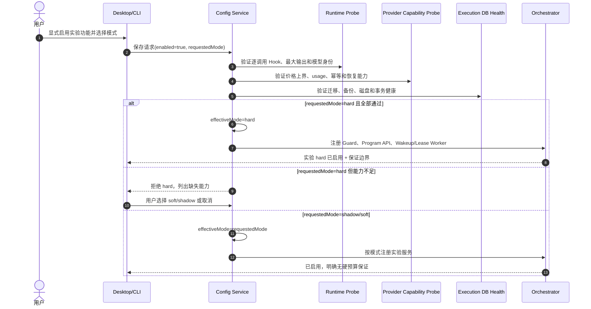

### 22.2 Program 创建、规划和准入

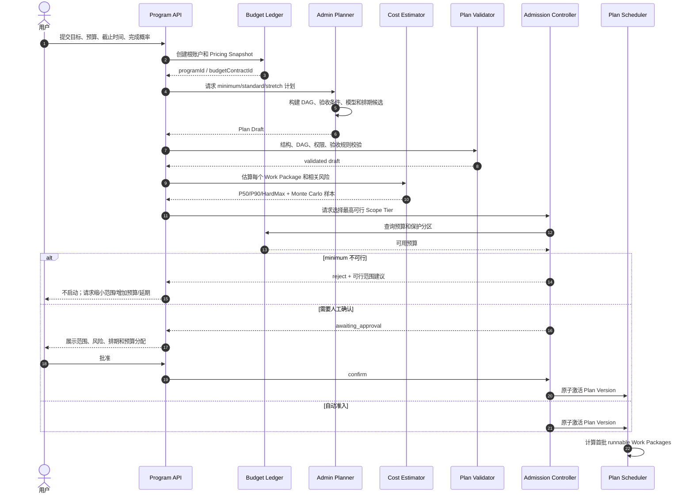

### 22.3 Work Package 正常执行

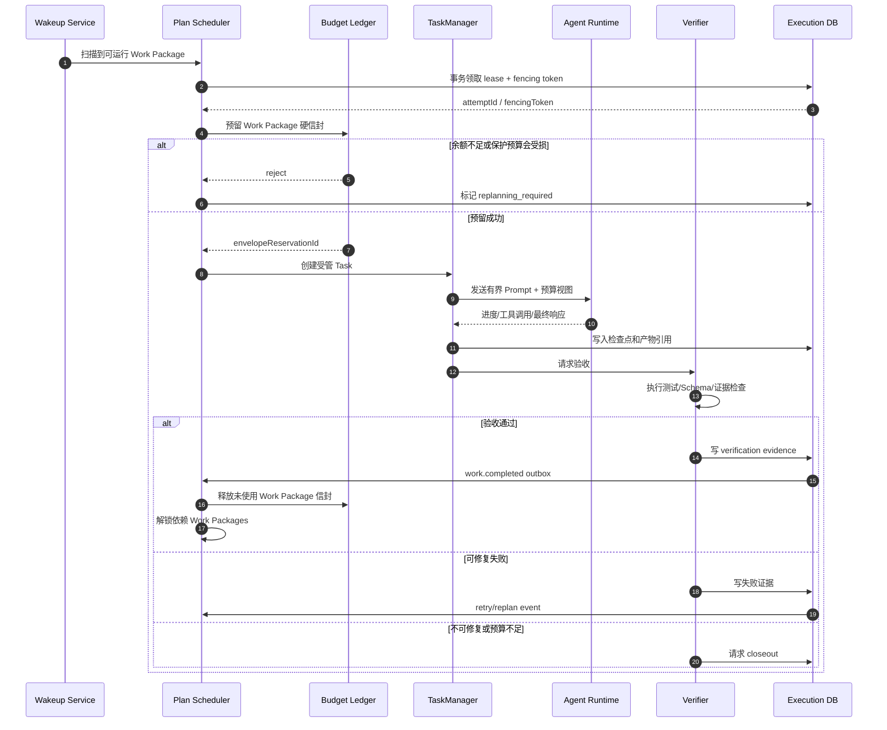

### 22.4 单次模型调用的预留与结算

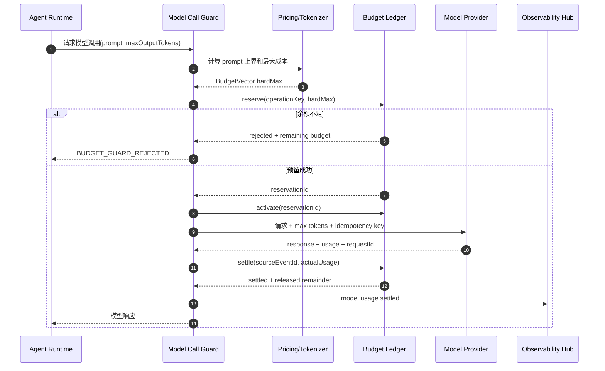

### 22.5 Leader 并行委派 Worker

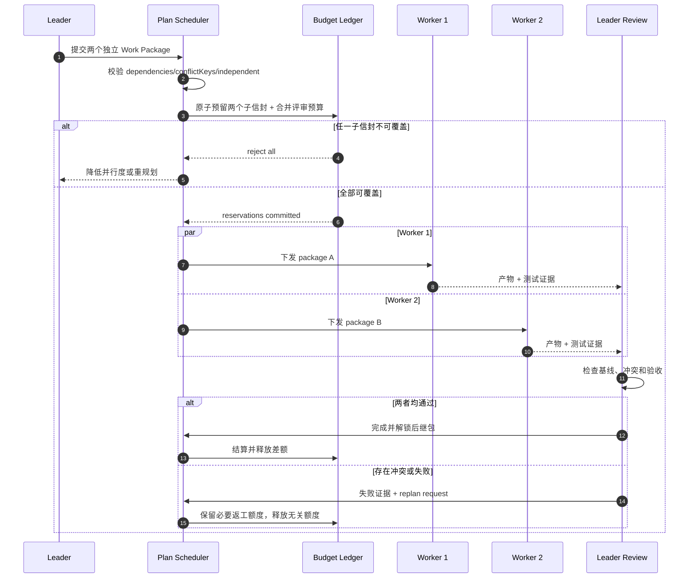

### 22.6 检查点触发重规划和范围降级

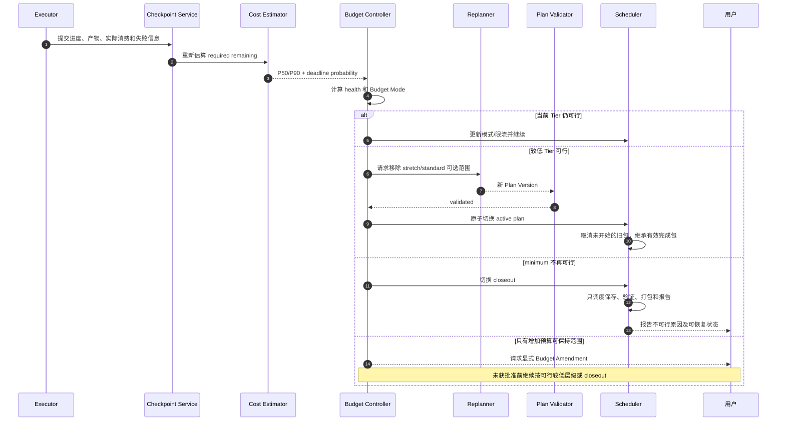

### 22.7 模型请求超时后的不确定结算与恢复

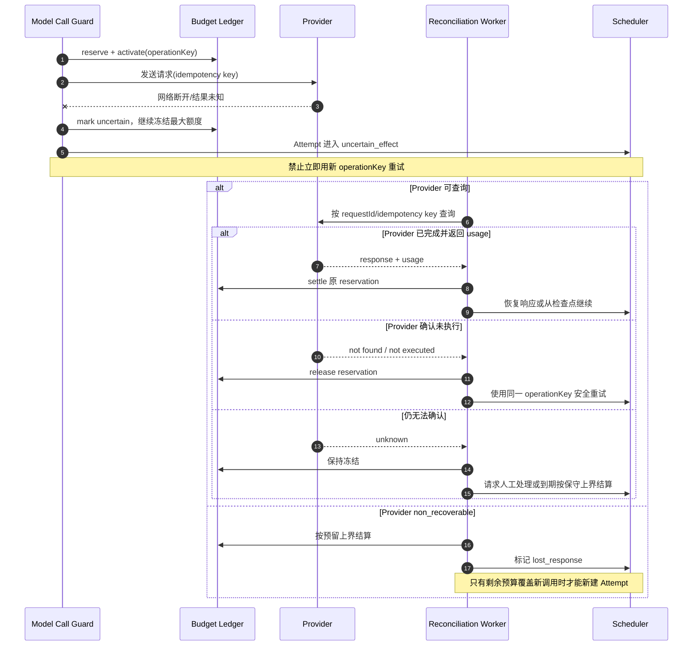

### 22.8 Orchestrator 崩溃与启动恢复

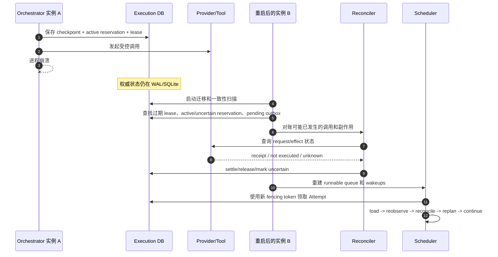

### 22.9 数周或数月后的持久化唤醒

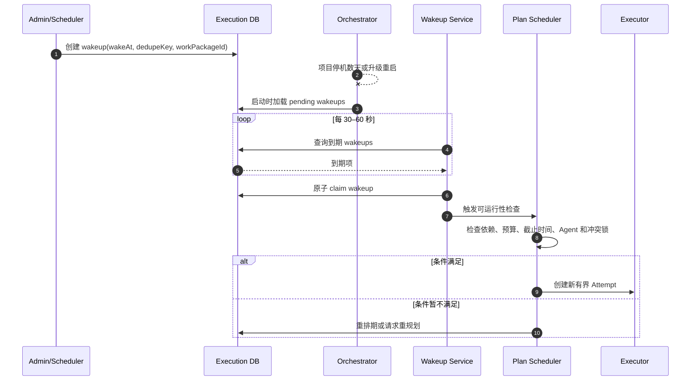

### 22.10 外部付费工具及副作用

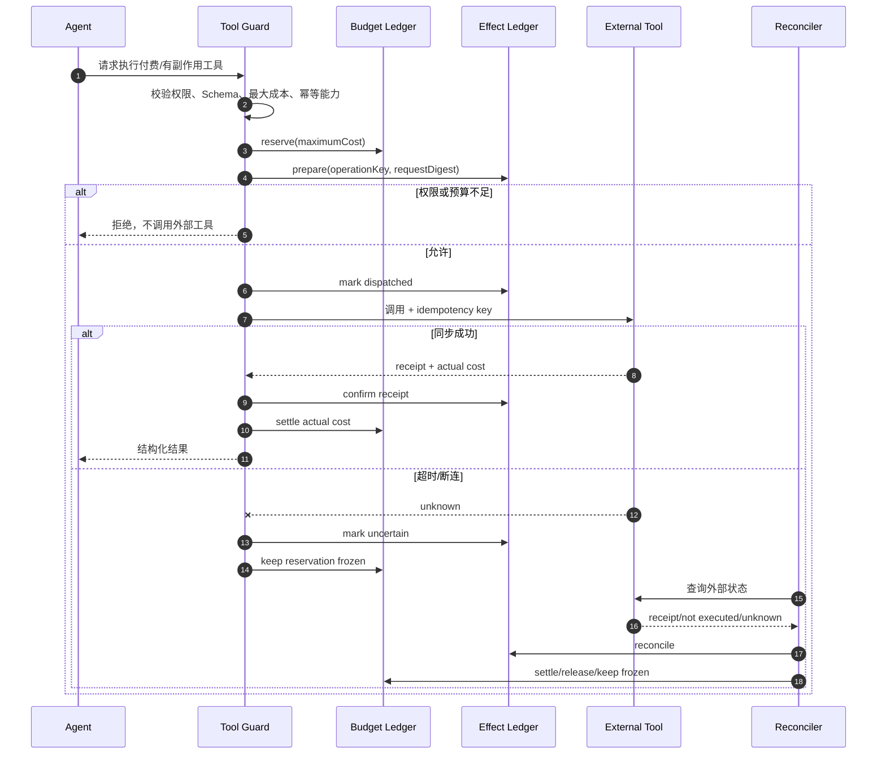

### 22.11 最终验证、发布和预算关闭

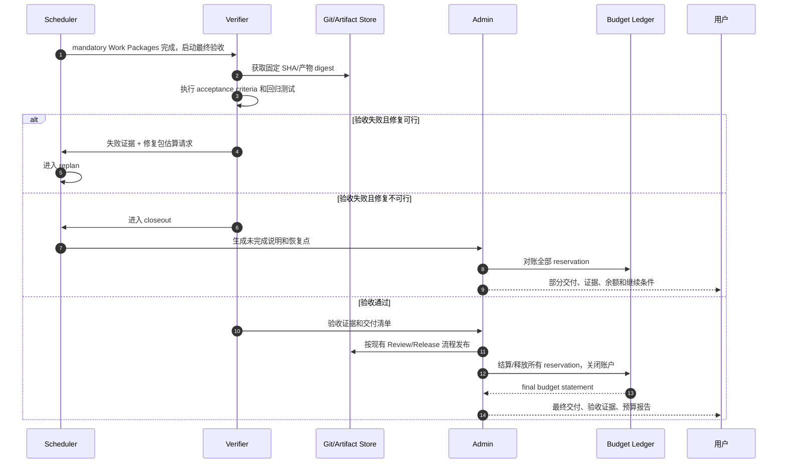

### 22.12 用户按钮/Admin 消息中止、快照与恢复

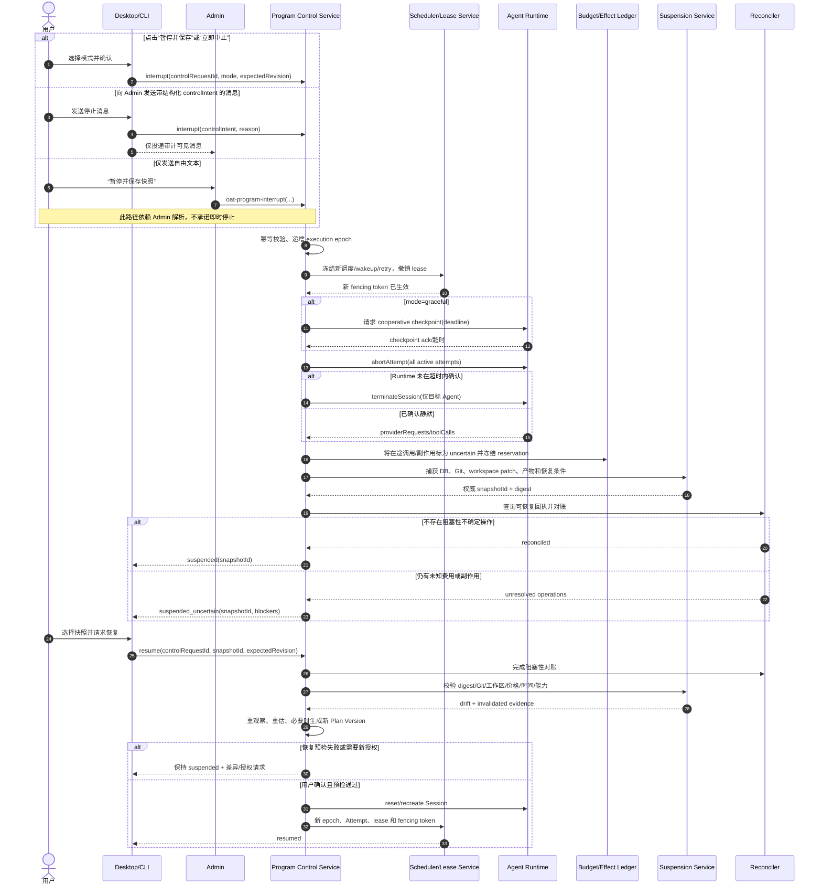

## 23. 与当前代码的具体映射

### 23.1 新增模块

```text
src/budget/budget-types.ts
src/budget/budget-repository.ts
src/budget/budget-ledger.ts
src/budget/pricing-service.ts
src/budget/cost-estimator.ts
src/budget/admission-controller.ts
src/budget/budget-guard.ts
src/budget/reconciler.ts

src/program/program-service.ts
src/program/program-control-service.ts
src/program/plan-validator.ts
src/program/replanner.ts
src/program/verification-service.ts
src/program/suspension-service.ts

src/scheduler/plan-scheduler.ts
src/scheduler/wakeup-service.ts
src/scheduler/lease-service.ts
src/scheduler/execution-barrier.ts
```

### 23.2 修改现有模块

| 文件 | 变化 |
| --- | --- |
| `src/config/schema.ts` | 增加 `budgetExecution` 配置和校验 |
| `src/types/orchestrator.ts` | 增加 Program/Plan/WorkPackage 引用和预算状态 |
| `src/orchestrator/task-manager.ts` | 普通 Task 保持现状；实验 Program 通过 ProgramService 投影到 Task board；Program 的运行中暂停由 Control Service 管理，不复用当前仅支持 queued Task 的 pause |
| `src/orchestrator/orchestrator.ts` | 仅在实验功能启用时注册 Program API、预算工具和启动恢复 |
| `src/orchestrator/usage-tracker.ts` | 保留统计投影，不再作为权威结算源 |
| `src/orchestrator/observability-hub.ts` | 增加预算、计划、唤醒和对账事件 |
| `src/sandbox/agent-runner.ts` | 接入 SDK 调用级 Hook 或 OAT Metering Proxy；增加 cooperative checkpoint、session abort、迟到事件 epoch 过滤 |
| `src/sandbox/local-process.ts` | 传递 Program/Attempt 上下文、operation ID、最大 Token 和 usage receipt；暴露 `abortAttempt`/`terminateSession` IPC |
| `src/sandbox/docker-process.ts` | 与本地 runtime 保持相同计量、中止、Session reset 和能力预检协议 |
| Desktop renderer | 增加 Program 预算、DAG、时间线、估算、对账、中止按钮、静默进度、快照选择和恢复预检 UI |

### 23.3 与现有 Scheduler Snapshot 的迁移

普通 Task 继续使用现有 scheduler snapshot；实验 Program 从第一版开始由 execution DB 单独管理完整生命周期。二者可以同时显示在 Task board，但不得对同一任务双写。未来若迁移普通 Task，应使用显式离线/事务迁移，不通过长期双写过渡。

实验 Program 必须处理：

- execution DB 已接受 Work Package，但 Task board 投影失败；
- reservation 已激活，但 Runtime dispatch 尚未成功；
- Attempt 已产生结果，但 settlement/verification 尚未完成；
- execution DB lease 已过期，但旧 Runtime 仍可能活动；
- 同一 Attempt 的重复 `message_end` 或工具回执。

通过单库事务、Outbox、幂等 operation key 和启动对账解决，不使用“重新执行一遍”作为恢复策略。Task board 投影失败不影响 Program 权威状态，修复投影也不能触发执行。

## 24. 实施里程碑

### M-1：Runtime 与 Provider 可行性 Spike（1 周，阻塞项）

当前 BLH-002 探针结果见 [Runtime 调用级 Hook Spike](./budgeted-runtime-hook-spike.md)：统一 stream 边界和中止能力可用，但 Provider 内部重试与权威 usage/request ID 仍是 hard-mode blocker。
BLH-004 已通过 [ADR 0003](./adr/0003-budget-execution-runtime-strategy.md) 选择 SDK ModelRuntime Wrapper 作为 shadow/soft 接入路径；当前 hard 为 No-Go，预检失败时必须拒绝而不能静默降级。

- 验证 `pi-coding-agent` 是否能在每次模型调用前后注入 Hook；
- 验证工具续轮、自动重试、压缩和内部调用是否全部经过 Hook；
- 为现有 Provider 生成 Budget Capability Profile；
- 验证最大输出 Token、实际模型身份、usage 和请求恢复能力；
- 确定采用 SDK Hook 还是 OAT Metering Proxy。

退出条件：至少一种受支持 Runtime/Provider 组合满足调用级门控。未满足时整个功能只能实现到 `shadow/soft`，禁止进入 `hard`。

### M0：测量基线和 Shadow Estimation（1–2 周）

- 定义 Program/Work Package Schema；
- 统一 usage event ID 和模型价格；
- 从历史 UsageRecord 建立任务类别成本基线；
- 估算器只记录不阻断；
- 输出 P50/P90 覆盖率报表。
- 功能仍默认关闭；实验启用后 effective mode 固定为 `shadow`。

退出条件：能够解释每笔模型费用归属到哪个 Task/Attempt。

### M1：统一账本与调用门控（2 周）

- SQLite Budget Ledger；
- reservation/settlement/reconciliation；
- 模型和工具 Guard；
- Pricing Snapshot；
- 重复 usage 事件幂等；
- 预算看板基础视图。
- Program/Queue/Attempt/Reservation 统一使用 execution DB；
- 先以 shadow/soft 验证，不默认开启硬阻断。

退出条件：并发和故障注入测试中账本不变量始终成立；soft 模式不会改变现有任务行为。

### M2：分层计划与准入（2 周）

- Scope Tier；
- Plan Version 和 Work Package DAG；
- Plan Validator；
- Monte Carlo Admission Controller；
- minimum 不可行时拒绝启动；
- closeout reserve 保护。

退出条件：任何被准入 Program 都有最小交付、验收条件、收尾预算和可解释估算。

### M3：持久化排期与恢复（2 周）

- Wakeup Service；
- lease/fencing；
- Continuation State；
- Program Control Service、Execution Barrier 和 Runtime abort；
- 中止后权威 Suspension Snapshot、迟到事件隔离和人工恢复预检；
- startup reconciliation；
- 外部副作用 Effect Ledger；
- 数月虚拟时钟测试。

退出条件：任意关键事务点崩溃后都不会重复消费或重复副作用；运行中的 Program 可从按钮或 Admin 结构化控制意图停止，并从权威快照安全恢复。

### M4：动态重规划和模型路由（2 周）

- Budget Mode；
- 检查点重新估算；
- 自动取消可选包和 Scope 降级；
- 规则型模型路由；
- Admin/Leader/Worker 预算工具。

退出条件：预算恶化时能自动完成更低但完整的交付层级。

### M5：灰度和策略学习（持续）

- 保持产品默认 `enabled=false`；
- 由明确选择的内部项目进入 shadow；
- 再对低风险任务启用 soft；
- 只有通过调用级门控、联合概率、账本线性一致性、Provider 能力和灾难恢复 Gate 的组合才可实验性启用 hard；
- 用历史轨迹优化估算、路由和协作拓扑；
- RL 或学习型策略只能优化软决策，不能替换硬账本。

## 25. 测试与验收计划

### 25.1 单元与属性测试

- 任意随机 reserve/settle/release 序列都保持账本不变量；
- 重复 `sourceEventId` 不重复扣费；
- 金额计算无浮点误差和溢出；
- 多维预算任一维不足都会拒绝；
- closeout/validation 账户不能被 execution 消费；
- DAG 环、缺失依赖和冲突计划被拒绝；
- Plan Version 切换不重复执行继承包。
- 多进程并发子 reservation 不会超卖父信封；
- Portfolio 与 Program 多层账户同时满足逐维不变量；
- 联合可行性结果不能由边际概率错误替代；
- `enabled=false` 时不注册写 API、工具、定时器或 Guard；
- shadow/soft 不会拒绝现有模型和工具调用。
- 重复 `controlRequestId` 不会重复中止、生成冲突快照或重复恢复；
- 只有当前 execution epoch 和 fencing token 能推进 Work Package 状态；
- Admin 自由文本不会被误当作已确认的即时控制请求；结构化 `controlIntent` 与按钮走同一服务；
- 快照打包器排除秘密、凭据、被忽略文件和未授权路径，并校验 patch/artifact digest；
- 模型预算为零时仍可执行本地静默、快照和状态持久化。

### 25.2 故障注入

在以下每一步之后强制终止进程并恢复：

1. reservation commit 后、请求发送前；
2. 请求发送后、Provider 返回前；
3. Provider 返回后、settlement 前；
4. settlement 后、Task 状态更新前；
5. 副作用发生后、receipt 保存前；
6. Work Package 完成后、依赖解锁前；
7. Plan Version 激活事务前后；
8. wakeup claim 前后；
9. lease 续租失败时；
10. Git 合并成功但 Release 状态未更新时。
11. SQLite busy、WAL checkpoint、磁盘写满和数据库恢复时；
12. 系统时钟回拨、长时间休眠和两个实例竞争 Lease 时；
13. Task board 投影失败、重复和乱序时；
14. Provider usage 延迟、重复、缺失和账单价格变化时；
15. stale fencing token 尝试执行外部副作用时。
16. 中止请求写入后、调度冻结前，以及冻结后、所有 Agent 静默前；
17. cooperative checkpoint 超时后切换到 `abortAttempt`，以及 abort 超时后终止 Session；
18. 每个 Program 阶段点击三种停止操作，包含多个并行 Worker 和等待中任务；
19. 旧 Runtime 在新 epoch 启动后发送迟到 message/tool/usage：只能对账，不得推进状态；
20. 快照已创建但 Program 状态尚未提交，以及恢复预检通过但新 lease 尚未创建；
21. 恢复前 Git 基线、工作区、Provider 价格、能力、截止时间或验收证据发生变化；
22. 高影响副作用不可取消或查询时保持 `suspended_uncertain`，不得错误显示安全暂停。

### 25.3 长时间仿真

使用虚拟时钟模拟：

- 90 天 Program；
- 每日/每周唤醒；
- 多次应用升级和重启；
- Provider 429、5xx、402 和价格变化；
- 用户长时间未审批；
- Worker 消失和 Team 配置变化；
- 截止时间逼近；
- 连续估算偏差触发降级。
- 多个 Program 同时竞争 Portfolio 预算和同一 Agent；
- Provider 月度额度不足但单个 Program 仍看似可行；
- Prompt/工具输出尝试要求 Admin 修改预算或绕过 Guard；
- 恶意或错误产物尝试欺骗 Verifier；
- 备份恢复和 Schema migration 中途崩溃。
- 暂停数周后手动恢复，验证 wakeup 不会在暂停期间偷偷执行；
- 恢复请求重复、跨设备同时提交和旧 revision 恢复冲突；
- 中止期间剩余预算为零、Admin 不响应或 Runtime 部分失联。

### 25.4 核心验收指标

```text
budget_overrun_total == 0
duplicate_external_effect_total == 0
unreconciled_reservation_age < policy threshold
P90 empirical coverage 接近配置目标
minimum-tier completion rate 显著高于固定均分预算基线
restart 后所有 active Program 均能恢复为可解释状态
disabled/shadow/soft 模式均不声称 hard budget guarantee
stale_fencing_external_effect_total == 0
portfolio_budget_overrun_total == 0
interrupt_to_quiesced_p95 < configured operational SLO
snapshot_secret_leak_total == 0
late_event_advanced_state_total == 0
resume_without_preflight_total == 0
```

## 26. 默认策略与待确认项

首版建议采用以下默认决策：

1. 功能默认 `enabled=false`；实验启用后的默认模式为 `shadow`。
2. 完成概率目标 90%；高风险 Program 可设 95%，但只有已校准估算器才能显示精确概率。
3. 最小交付、验证、风险和收尾预算在准入时一次保护。
4. Validation/Closeout 使用 `max(configuredFloor, estimatedP95)`，固定比例只是冷启动 floor，不是最终分配结果。
5. Work Package 目标时长不超过 2 小时；超过则要求拆分。
6. 单包最多自动重试 2 次，且重试共享固定信封。
7. 相同失败连续出现 2 次立即重规划，不继续盲目重试。
8. 默认最多 4 个并行包；预算健康低于 1.2 时降为 1。
9. 唤醒扫描 30 秒；lease 120 秒；heartbeat 30 秒。
10. 不支持幂等且有高影响副作用的工具必须人工确认；hard 无人值守模式直接禁止。
11. usage 缺失按预留上界结算，后续可对账返还。
12. MVP 先覆盖 Token 和工具调用次数；真实金额只有在价格上界及账单对账可信后才可硬限制。
13. “暂停并保存”宽限期默认 10 秒，Runtime abort 超时默认 5 秒；“立即中止”跳过 cooperative 等待。
14. 默认要求用户手动恢复；只有无高影响副作用、无未知费用且恢复预检通过的低风险场景才可另行实验自动恢复。
15. 控制按钮直接调用控制面；向 Admin 发送的纯自由文本不声称具备即时中止保证。

以下产品决策必须在进入 `soft` 前明确，不能推迟到 hard 实现之后：

- 用户是否必须显式批准 `minimum/standard/stretch` 定义；
- deadline 是硬截止还是软目标；
- Program 暂停期间是否计算时间预算；
- 预算余额是否允许跨 Program 转移；
- 何种范围降级可以自动执行，何种必须用户确认；
- 外部服务费用由 OAT 价格目录还是 Provider 对账单作为最终事实源。
- 暂停期间 deadline/时间预算是继续计时、顺延，还是恢复时重新协商；
- `interrupt_now` 是否允许在无二次确认时由全局紧急停止按钮触发；
- 哪些外部副作用属于恢复阻塞项，哪些可由用户接受风险后继续。

## 27. 最终设计原则

本架构的核心不是让 Admin “更节省”，而是把 Admin 放在受约束的规划闭环中：

```text
提出计划 -> 验证可行 -> 预留完成预算 -> 有界执行
-> 检查点验收 -> 重新估算 -> 继续/降级/收尾
```

Admin 的价值在于理解目标、拆解范围和处理变化；Budget Controller 的价值在于确保每一个动作都符合已经批准的资源契约。只有把概率性智能和确定性控制分开，数天乃至数月的任务才可能同时具备自主性、预算可控性、故障可恢复性和可交付性。
