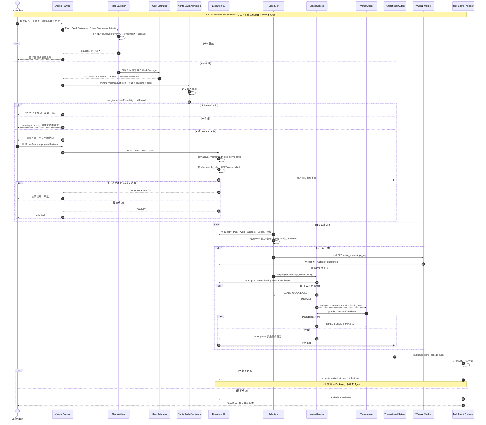

# BLH-021～030：计划、准入、调度与长期运行基础

> 状态：计划与调度基础组件已实现，BLH-026～030 生产集成仍为 partial。全部能力仍为实验性，受父开关 `budgetExecution.enabled` 控制，默认 `false`；当前 hard 模式仍为 No-Go。关闭时不打开 Execution DB、不启动 Program worker，也不注册实验 Program 路由。

## 1. 模块边界

`program-planning-service.ts` 已提供计划提交、准入评估、查询和审批激活的业务入口，并在实验父开关开启时接入 Orchestrator。接口、版本约束及冷启动估算边界见 [Program 计划 API](./program-planning-api.md)。

| 任务 | 实现 | 核心保证 |
| --- | --- | --- |
| BLH-021 | `acceptance-criteria.ts`、Schema v3 `acceptance_criteria` | 验收条件为严格判别联合；mandatory 工作不能只依赖 LLM 自证 |
| BLH-022 | `plan-validator.ts` | 工作集、归属、stable key、DAG、依赖、Tier 闭包、验收和硬信封统一校验 |
| BLH-023 | `cost-estimator.ts`、`work_package_estimates` | 每个包记录 P50/P90/P95/HardMax、持续时间、样本量、置信度和估算器版本 |
| BLH-024 | `admission-controller.ts`、`admission_decisions` | 固定 seed 的相关 Monte Carlo，输出预算/期限/成功率边际值和真正的联合概率 |
| BLH-025 | `scope-tier-selector.ts` | minimum 不可行时拒绝启动；不以“先做一半”代替可交付计划 |
| BLH-026 | `plan-activation-service.ts` | revision CAS 下原子激活 Plan、绑定 Program、开放根任务和追加 Outbox |
| BLH-027 | `plan-scheduler.ts` | 依赖、Tier、模式、冲突、并发、能力、时间与预算全部通过才可选择；排序确定 |
| BLH-028 | `lease-service.ts` | 每次重领递增 fencing token；过期 owner 不能续租或提交状态 |
| BLH-029 | `wakeup-service.ts`、`program-wakeup-runtime.ts`、`wakeups` | 唤醒与 Outbox 同事务；专用消费者接入常驻调度，重启补发、暂停延期及 epoch 隔离 |
| BLH-030 | `task-board-projection.ts`、`task_board_projections` | Task Board 是单向 UI 投影；失败可重试但不修改事实、不触发执行 |

## 2. 计划与准入不变量

1. Plan 中 `workPackageIds` 必须与提交校验的 Work Package 集合完全相等。
2. stable key 在 Plan 内唯一；所有依赖都存在、无环，且低 Tier 不能依赖高 Tier。
3. mandatory 包至少包含一种确定性或人工可验证条件；`llm_judge` 只能作为辅助证据。
4. 每个包有非零 HardMax。历史 P90 若超过 HardMax，估算直接失败，不能静默扩大预算。
5. Monte Carlo 先按 DAG 拓扑序计算关键路径；同一 risk group 使用共享风险因子，避免把相关失败当独立事件。
6. 只有“预算内、期限内、全部 mandatory 成功”同一采样同时成立才计入联合成功率。未校准估算不声称精确概率，转人工审批。
7. Tier 选择从 stretch 向 minimum 找最高可行层；minimum 不可行直接 rejected。

## 3. 原子激活与确定性调度

激活事务先验证 Plan 与两个 revision，再把 Plan 置为 active、Program 置为 admitted 并绑定 active Plan。选定 Tier 之外的包取消；选定 Tier 内无依赖的根包转 runnable；所有 UI/调度通知只写 Transactional Outbox。任何一步或故障注入失败，整个事务回滚。

Runnable 选择器是只读纯决策：只有 Program running、Plan active、状态 runnable、依赖完成、未到 `notBefore`、未过 deadline、无冲突键、Agent 可用、并发有空位且累计 HardMax 能放入 execution 可用额度时才返回。排序固定为 `priority DESC, deadline ASC, createdAt ASC, id ASC`。

预算模式限制：

- `explore`：可使用选定 Tier；
- `balanced`：最高只到 standard；
- `commit`：只运行 mandatory minimum；
- `closeout`：不再选择普通执行包，保留 validation/closeout 保护分区。

## 4. Lease、Wakeup 与投影

Lease 获取和 Attempt 创建、Work Package 状态更新在同一 SQLite immediate transaction 中。活动 Lease 存在时第二 owner 被拒绝；过期重领先把旧 Attempt 标为 expired，再分配严格递增的 token。续租和状态提交必须同时匹配 `attempt_id + owner_id + fencing_token` 且尚未过期。

Wakeup 是事实记录，不依赖进程内 timer。到期扫描按 `wake_at, priority DESC, id` 排序，在同一事务插入稳定 Outbox 事件并标为 dispatched。崩溃发生在任一写入之后都会回滚；已 dispatched 的记录不会因时钟回拨再次执行。

Task Board worker 只消费已经 published 的 Work Package Outbox 事件。投影写入独立 map/table，不写 `taskById`、Agent FIFO 或 Program 事实表；投影适配器失败只记录 failed/attempts/last_error，后续重试。

## 5. 完整时序图

以下展示组件协议；首批自动验收及持久化 Wakeup 已接入生产 tick，共享 SQLite 的跨实例 owner/fence、资源占用与保守接管已接入。唤醒的至少一次消费、重放和恢复边界见[持久化唤醒运行时](./persistent-wakeup-runtime.md)。

## 6. 仍未开放的保证

Program Coordinator 已以常驻 10 秒循环连接计划选择、预算预留、Lease/Fencing 和 TaskManager；ReviewPending 继续续租，Task Completed 后进入 `verifying` 并执行文件、命令或 JSON 测试报告验收。证据提交检查 epoch/lease，成功后推进工作包和后续依赖，活动计划完成后触发 Closeout；其他验收 Adapter 仍待接入。Wakeup 已通过专用 Outbox 消费者驱动常驻调度；共享 SQLite 的跨实例调度已集成，远端会话迁移仍待扩展。Checkpoint、中止/恢复 API、启动恢复及 Desktop 控制入口已实现，具体边界见 [Checkpoint、中止恢复与外部副作用安全](./checkpoint-interrupt-effects-runtime.md)。SDK 模型流、OAT/SDK 工具执行入口已接入预算与副作用网关，首批状态查询用于对账且未决操作阻止自动完整交付；Provider 权威计费、其他工具 Adapter、集成长周期仿真及真实发布观察证据仍待补齐。父开关继续默认关闭，shadow/soft 不得宣传为“硬预算保证”，hard 继续 fail closed。

有限重试、完成项证据继承、原子计划切换、配置式模型路由及带恢复点的安全收尾已接入常驻 tick，详见[重规划、规则路由与收尾运行时](./replanning-routing-closeout-runtime.md)。

Schema v7 的 owner/fence、原子派发、项目资源占用和保守故障接管见[跨实例调度协调](./cross-instance-scheduling-runtime.md)。
